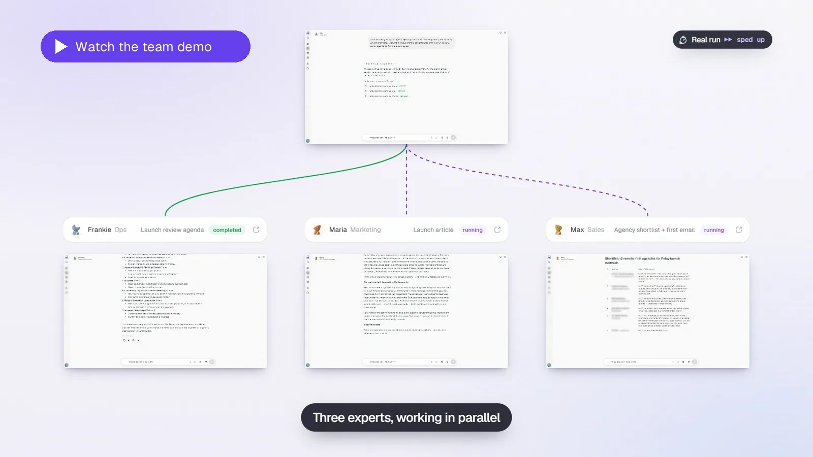

  

<h1 align="center">AutoGPT — Your team of AI Experts</h1>

  Bring in specialists for content, sales, research, and recurring work. 
  Brief them in plain English. Let <strong>Otto</strong> coordinate.

  <a href="https://platform.agpt.co/signup?utm_source=github&amp;utm_medium=referral&amp;utm_campaign=autogpt_readme&amp;utm_content=header_get_started"><strong>Get started</strong></a>
  ·
  <a href="#see-the-team-at-work">Watch the demo</a>
  ·
  <a href="https://agpt.co/experts/?utm_source=github&amp;utm_medium=referral&amp;utm_campaign=autogpt_readme&amp;utm_content=header_experts">Meet the Experts</a>
  ·
  <a href="https://agpt.co/pricing/?utm_source=github&amp;utm_medium=referral&amp;utm_campaign=autogpt_readme&amp;utm_content=header_pricing">Pricing</a>
  ·
  <a href="#self-host-autogpt">Self-host</a>
  ·
  <a href="#build-with-us">Contribute</a>

## One conversation. The right expertise.

Tell Otto what's on your plate. It brings in the right Experts, hands over the work, and keeps you up to date. Talk to a specialist directly when you want to get into the details.

Each Expert has a role you can shape with your instructions, context, skills, and connected apps. Start with a ready-made specialist or create your own.

| Meet your team | Put them to work |
| --- | --- |
| **Otto · Head of AI** | Coordinate a job across specialists and bring their work back to you. |
| **Maria · SEO Content Manager** | Turn a target keyword into a content brief and article draft. |
| **Max · Account Executive** | Research prospects, draft outreach, and prepare the next conversation. |
| **Frankie · Executive Assistant** | Prepare meeting context, email drafts, and a digest for the day. |

[Explore the Experts →](https://agpt.co/experts/?utm_source=github&utm_medium=referral&utm_campaign=autogpt_readme&utm_content=team_experts)

## See the team at work

One launch brief to Otto. Maria prepares the article, Max researches prospects, and Frankie prepares the launch review.

**[Watch the 45-second demo →](https://agpt.co/videos/otto-team-demo-v1-1080.mp4)** · [Download the 15-second highlight](docs/content/imgs/readme/experts-demo.mp4?raw=true) · [Try the interactive demo](https://platform.agpt.co/tour?utm_source=github&utm_medium=referral&utm_campaign=autogpt_readme&utm_content=tour_get_started)

An edited recording of a real run, sped up. In this example, the team prepares the work for review without sending or publishing it.

## From a first brief to a routine

1. **Choose your Expert.** Tell Otto what you need, pick a specialist, or create one for your own way of working.
2. **Brief them on the job.** Share the context, connect the apps they need, and agree on the first outcome.
3. **Review and refine.** Check the work and adjust the instructions. Activate routines for jobs that keep coming back.

You choose which accounts each Expert can access, set spending approval thresholds, and follow progress in their activity.

[See how it works →](https://agpt.co/how-it-works/?utm_source=github&utm_medium=referral&utm_campaign=autogpt_readme&utm_content=how_it_works)

## Get started

### AutoGPT Platform

Use the hosted Platform to get your team running without managing the infrastructure or supplying model API keys.

**[Get started on AutoGPT Platform →](https://platform.agpt.co/signup?utm_source=github&utm_medium=referral&utm_campaign=autogpt_readme&utm_content=platform_get_started)**

The hosted Platform is a paid service. See [current plans, trial terms, and usage pricing](https://agpt.co/pricing/?utm_source=github&utm_medium=referral&utm_campaign=autogpt_readme&utm_content=platform_pricing).

### Self-host AutoGPT

Run AutoGPT on your own infrastructure. You provide model credentials, configure the deployment, and manage its updates and operation.

Follow the [self-hosting guide](https://docs.agpt.co/platform/self-hosting/getting-started/) for current requirements and supported installation paths. The [installer reference](docs/platform/installer.md) tracks appliance release availability; use the manual setup while its release gates are pending.

[Read the self-hosting guide →](https://docs.agpt.co/platform/self-hosting/getting-started/)

| | Hosted Platform | Self-hosted |
| --- | --- | --- |
| Setup and operations | Managed by AutoGPT | Managed by you |
| Model access | Built in | Bring your own model credentials |
| Cost | Paid plan and usage | Your infrastructure and model usage |
| Data and infrastructure | Hosted by AutoGPT | Runs on your infrastructure |

See the [license](#license) for the repository's usage terms.

## Workflows when you need more control

Experts can use skills and workflows to do their jobs. The visual builder lets you define repeatable steps, connect tools, and inspect how work runs. Start with a workflow from the marketplace or build your own.

- **[Visual builder](https://agpt.co/product/build/?utm_source=github&utm_medium=referral&utm_campaign=autogpt_readme&utm_content=build):** connect blocks, branch logic, and control the steps.
- **[Marketplace](https://agpt.co/product/marketplace/?utm_source=github&utm_medium=referral&utm_campaign=autogpt_readme&utm_content=marketplace):** discover workflows you can adapt to your work.
- **[Integrations](https://agpt.co/docs/integrations):** connect the tools your team uses.

## Build with us

Explore the code, report a problem, or help improve AutoGPT.

| Resource | Where to go |
| --- | --- |
| Platform source and development setup | [autogpt_platform/](autogpt_platform/README.md) |
| Documentation | [docs.agpt.co](https://docs.agpt.co/) |
| Contributing | [CONTRIBUTING.md](CONTRIBUTING.md) |
| Bugs and feature requests | [GitHub Issues](https://github.com/Significant-Gravitas/AutoGPT/issues/new/choose) |
| Community and support | [Discord](https://discord.gg/autogpt) |

## License

AutoGPT's code is available in this repository under two licenses:

| Component | License |
| --- | --- |
| `autogpt_platform/` | [PolyForm Shield 1.0.0](autogpt_platform/LICENSE.md), including its restrictions on competing products and services |
| Everything outside `autogpt_platform/`, including Classic | [MIT](LICENSE) |

## AutoGPT Classic

Looking for the original standalone AutoGPT? Explore [Classic](classic/README.md), [Forge](classic/forge/README.md), or [agbenchmark](https://pypi.org/project/agbenchmark/).

## Contributors

  <a href="https://platform.agpt.co/signup?utm_source=github&amp;utm_medium=referral&amp;utm_campaign=autogpt_readme&amp;utm_content=footer_get_started"><strong>Meet your AI team →</strong></a>

---

<!-- Keep these links. Translations will automatically update with the README. -->
[Deutsch](https://zdoc.app/de/Significant-Gravitas/AutoGPT) |
[Español](https://zdoc.app/es/Significant-Gravitas/AutoGPT) |
[français](https://zdoc.app/fr/Significant-Gravitas/AutoGPT) |
[日本語](https://zdoc.app/ja/Significant-Gravitas/AutoGPT) |
[한국어](https://zdoc.app/ko/Significant-Gravitas/AutoGPT) |
[Português](https://zdoc.app/pt/Significant-Gravitas/AutoGPT) |
[Русский](https://zdoc.app/ru/Significant-Gravitas/AutoGPT) |
[中文](https://zdoc.app/zh/Significant-Gravitas/AutoGPT)
