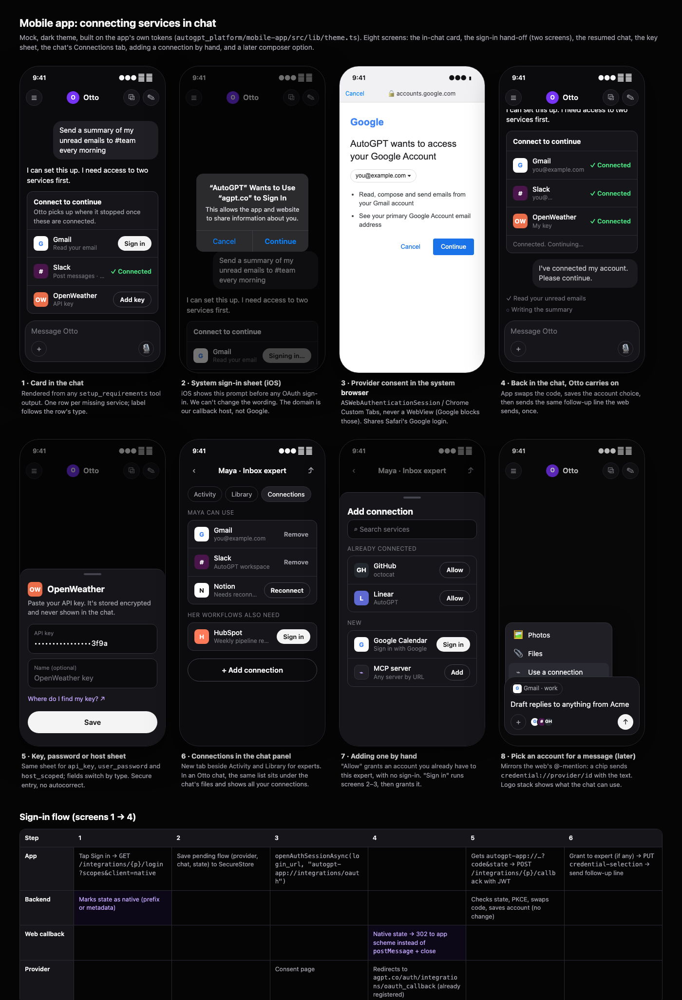

# Mobile app: connecting services in chat

Plan for letting Otto and experts in the mobile app (`autogpt_platform/mobile-app`) ask for, and use, connected services the way the web chat does: a card with sign-in buttons in the chat, and a list of the chat's connections that you can add to by hand. Tracked in [SECRT-3552](https://linear.app/autogpt/issue/SECRT-3552).

Related notes: [OAuth integration flow](../oauth-integration-flow.md) (the web flow this builds on) and [backend handoff](backend-handoff.md) (its "Google and connection handoff" row is the server slice below).

## Mock

Open [`connections/mock.html`](connections/mock.html) in a browser for the full mock. It uses the app's own colour tokens from `autogpt_platform/mobile-app/src/lib/theme.ts`.

## Where we are

- **Mobile app** (`autogpt_platform/mobile-app`): no support. `steps.ts` turns every tool output except onboarding into a step row. A `setup_requirements` result shows as a ticked step, so nothing tells the user a service is missing. The README lists "connecting integrations" and "credential cards" as not done. `expo-web-browser` is not installed and nothing handles incoming links (scheme `autogpt-app` exists in `app.json`).
- **Web**: `SetupRequirementsCard` / `ChainActionCard/ConnectorRow` → `ConnectCredentialDialog` → `useOAuthConnect` (popup + `postMessage` from `/auth/integrations/oauth_callback`) or `POST /integrations/{p}/credentials`. Afterwards the **client** resumes the chat: `PUT /chat/sessions/{id}/credential-selection`, then sends a fixed line ("I've connected my account. Please continue."). The backend only resumes *scheduled* chats.
- **Backend**: the OAuth redirect is fixed to `{frontend_base_url}/auth/integrations/oauth_callback` (`_get_provider_oauth_handler` in `backend/api/features/integrations/router.py`; MCP: `backend/api/features/mcp/routes.py`). PKCE verifier and state live server-side, per user. `POST /{p}/callback` needs the user's JWT. The [backend handoff](backend-handoff.md) already lists "Google and connection handoff" as an unbuilt backend slice.

## Proposal

### Server (built)

1. `GET /integrations/{p}/login?client=native` (and `POST /mcp/oauth/login` with `client: "native"`) mints a state token that starts with `native.` (`NATIVE_STATE_PREFIX` in `credentials_store.py`; `token_urlsafe` never emits `.`).
2. The web `oauth_callback` and `mcp_callback` routes: if `state` has the prefix, answer `302 autogpt-app://integrations/oauth?code&state[&iss]`, or `?state&error[&error_description]` on failure, instead of `postMessage` + `window.close()`. Shared helper: `frontend/src/app/(platform)/auth/integrations/native-return.ts`. The target is fixed to the address the app registers and waits for, so the code never goes to a web address.
3. No change to the code swap, PKCE or storage. No new redirect URI to register with Google, GitHub and the rest.

Why the prefix: the callback page has no user and can't look up a state, so the "send to app" flag must ride in the state itself. A leaked code is useless without that user's JWT and the server-held PKCE verifier.

### App

**Phase 1 — card in chat (screens 1–5, built)**
- `groupParts` gets a `setup` block for any part whose output has `type: "setup_requirements"` (connect_integration, run_block, run_agent, schedule_agent, run_mcp_tool, …). Card lists `setup_info.user_readiness.missing_credentials`; reuse the `OnboardingCard` pattern (`helpers.ts` parser + hook).
- Row action by type: `oauth2` → "Sign in"; `api_key` / `user_password` / `host_scoped` → "Add key" sheet; `credential_gap` → "Reconnect" / "Grant access"; `expert_grant` → "Allow" (grant only, no sign-in).
- OAuth: `expo-web-browser` `openAuthSessionAsync(login_url, "autogpt-app://integrations/oauth")` → parse `code`, `state` and `iss` → `POST /integrations/{p}/callback`, or for an MCP server `POST /mcp/oauth/callback` with `iss` when the return has one (the MCP handler refuses a missing `iss` when the server requires it).
- A return with `error` instead of `code` is matched to its pending flow by `state`, clears it and offers the row again, without calling either exchange. `access_denied` reads as a cancel; anything else shows "didn't finish the sign-in".
- After connect, once **every** row on the card is connected (as the web waits for all providers): expert chat → `POST /experts/{id}/credentials`; then `PUT credential-selection`, and only if it succeeds, send the same follow-up line the web sends, only if connected in this app run (history reload stays silent). A failed selection offers "Try again" instead of resuming on an account recorded earlier.
- New `src/lib/api/integrations.ts` (hand-written, like the rest of the app).

**Phase 2 — Connections in the chat panel (screens 6–7, built)**
- Expert chat: "Connections" tab in `ExpertPanel` beside Activity and Library. `GET /experts/{id}/credentials`, "also needs" from `GET /experts/setup`, Remove → `DELETE /experts/{id}/credentials/{cid}`.
- Otto chat: "Your connections" section in `FilesPanel` from `GET /integrations/credentials`.
- "Add connection" sheet: already-connected accounts ("Allow") + providers from `GET /integrations/providers`.

**Phase 3 — later**
- Composer "Use a connection" (web's `credential://provider/id` mention) and the logo stack.
- Device-code providers (Microsoft, Codex, Stripe Link): show code + "Copy and open", poll `/device-auth/poll`.
- MCP manual token, Ayrshare SSO.

## Caveats

1. **Server work first.** Without the native bounce the app can't finish any OAuth sign-in. Key-type services (phase 1 sheet) work with no server change, so they could ship first.
2. **No WebView.** Google refuses OAuth in embedded WebViews (`disallowed_useragent`); others are heading the same way. So the Settings WebView is no fallback for Google. Use the system session (iOS `ASWebAuthenticationSession`, Android Custom Tabs) via `expo-web-browser`.
3. **iOS prompt.** iOS shows "“AutoGPT” Wants to Use “agpt.co” to Sign In" before every sign-in. `preferEphemeralSession` removes it but then the user types their Google password every time. Keep the prompt.
4. **Android loses the app.** Low memory can kill the app while Custom Tabs is open; the result then arrives as a cold-start deep link. Add an `integrations/oauth` route that finishes the swap, and save the pending flow (provider, chat, state) before opening the browser. Keep it until the swap ends, so a kill during the swap can still finish from the same link. After the swap the account is in the user's list, so a kill before the grant or selection needs no extra checkpoint: reopened, the card matches the new account from `GET /integrations/credentials` and offers Allow or Continue, and the expert panel offers Allow. Never a second swap or sign-in.
5. **Scheme hijack (Android).** Another app could claim `autogpt-app://`. The code alone is useless (needs JWT + PKCE verifier), so low risk. App Links (verified https) would close it but need `assetlinks.json` / `apple-app-site-association` on the web host.
6. **Expo Go and local dev.** On iOS the system sign-in session catches `autogpt-app://` itself, so Expo Go works. On Android the scheme must be registered, so test there in a development build. On a physical phone the provider sends you to `localhost:3000`, which is the phone; only the simulator or a preview environment works end to end.
7. **Resume is client-driven.** If the user has the same chat open on web and phone, both could send the follow-up. Keep the web's "only if connected in this app run" rule; a server-side resume would be cleaner but is a separate change.
8. **Paywall.** `login` and `credentials` endpoints run `enforce_payment_paywall`. The app has no paywall UI, so show "Finish this on the web" on 402.
9. **Secrets on a phone.** Secure entry, no autocorrect or suggestions, never through chat; clear fields on close. iOS may offer to save to Passwords; fine.
10. **Card variety.** The web merges cards in a tool chain, has trigger and preview modes and input fields. Phase 1 covers credentials only; cards that also need inputs say "Finish this on the web" and open the chat there.
11. **Copy.** Web buttons say "Connect"; the mock uses "Sign in" for OAuth and "Add key" for keys as asked. Pick one before building. No "agent" or "graph" in any string.
