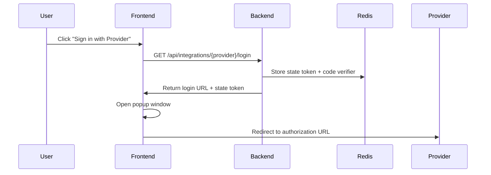
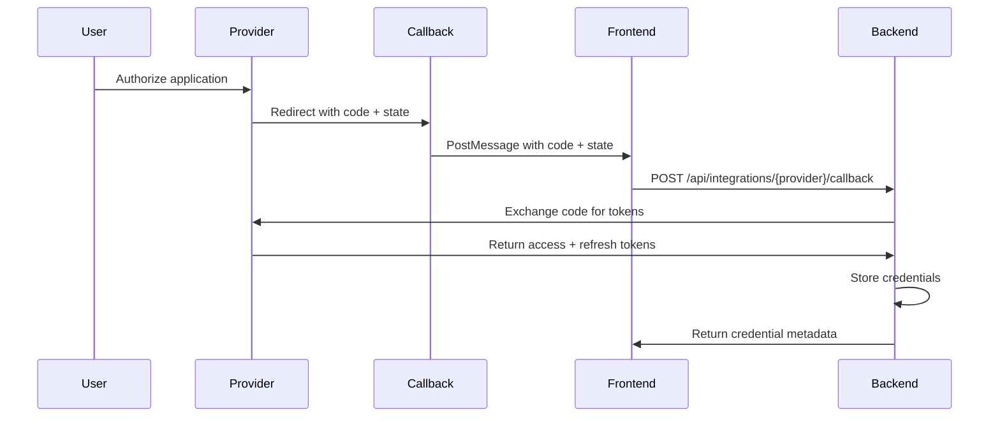
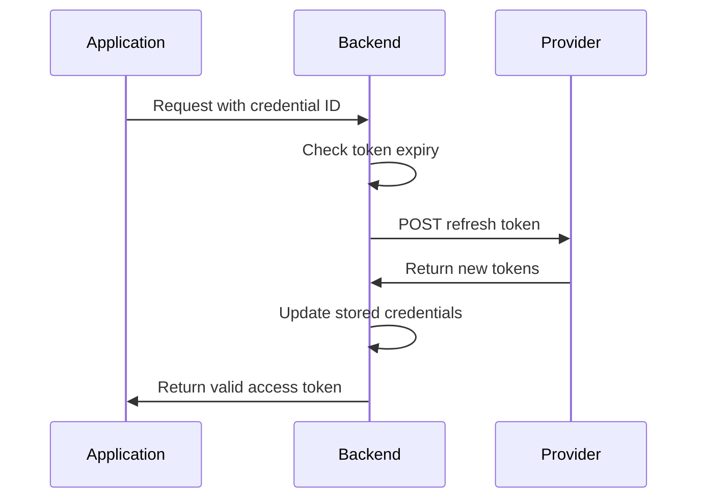
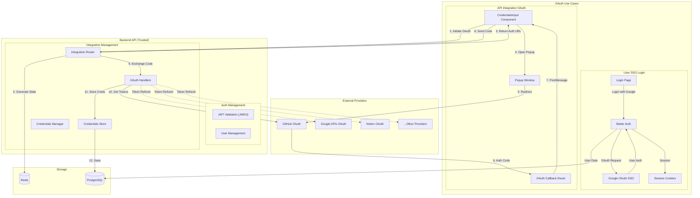
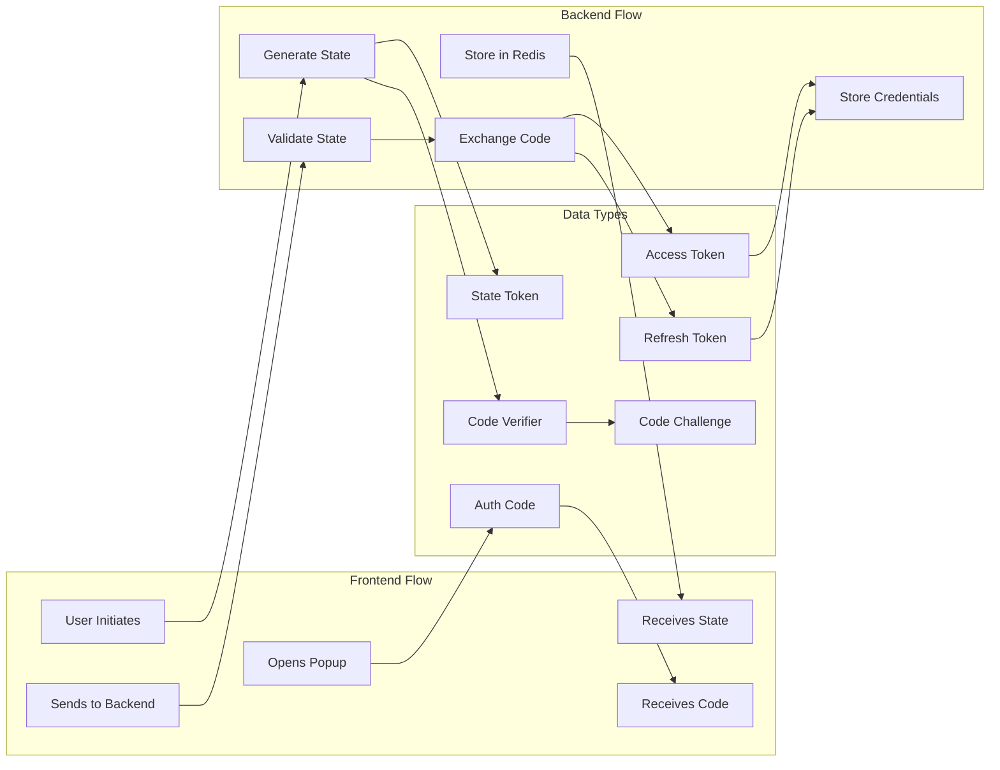
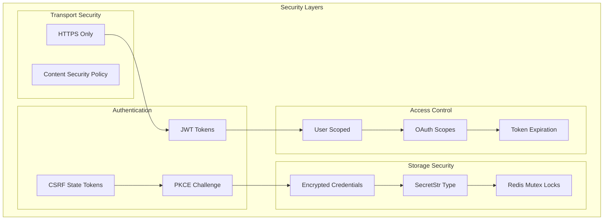
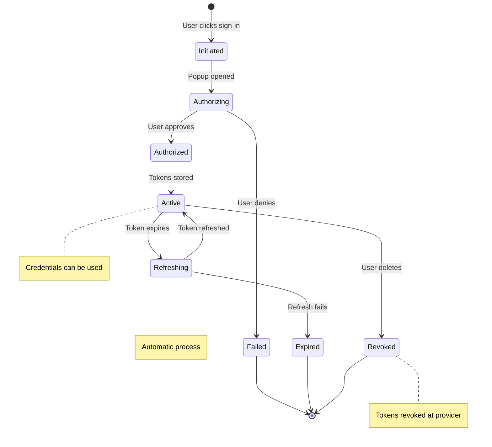

# OAuth Integration Flow Documentation

## Overview

The AutoGPT Platform implements OAuth 2.0 in two distinct contexts:

1. **User Authentication (SSO)**: Handled by Better Auth, embedded in the Next.js frontend at `/api/auth/*`
2. **API Integration Credentials**: Custom OAuth implementation for third-party service access

This document focuses on the **API Integration OAuth flow** used for connecting to external services. For the list of supported providers, see `autogpt_platform/backend/backend/integrations/providers.py`. For user authentication documentation, see `autogpt_platform/frontend/src/lib/auth/SESSION_VALIDATION.md`.

## Trust Boundaries

### 1. Frontend Trust Boundary
- **Location**: Browser/Client-side application
- **Components**: 
  - `CredentialsInput` component (`autogpt_platform/frontend/src/components/contextual/CredentialsInput/CredentialsInput.tsx`)
  - OAuth callback route (`autogpt_platform/frontend/src/app/(platform)/auth/integrations/oauth_callback/route.ts`)
- **Trust Level**: Untrusted - user-controlled environment
- **Security Measures**:
  - CSRF protection via state tokens
  - Popup-based flow to prevent URL exposure
  - Message validation for cross-window communication

### 2. Backend API Trust Boundary
- **Location**: Server-side FastAPI application
- **Components**:
  - Integration router (`autogpt_platform/backend/backend/api/features/integrations/router.py`)
  - OAuth handlers (`autogpt_platform/backend/backend/integrations/oauth/`)
  - Credentials store (`autogpt_platform/backend/backend/integrations/credentials_store.py`)
- **Trust Level**: Trusted - server-controlled environment
- **Security Measures**:
  - JWT-based authentication
  - Encrypted credential storage
  - Token refresh handling
  - Scope validation

### 3. External Provider Trust Boundary
- **Location**: Third-party OAuth providers
- **Components**: Provider authorization endpoints
- **Trust Level**: Semi-trusted - external services
- **Security Measures**:
  - HTTPS-only communication
  - Provider-specific security features
  - Token revocation support

## Component Architecture

### Frontend Components

#### 1. CredentialsInput Component
- **Purpose**: UI component for credential selection and OAuth initiation
- **Key Functions**:
  - Displays available credentials
  - Initiates OAuth flow via popup window
  - Handles OAuth callback messages
  - Manages credential selection state

#### 2. OAuth Callback Route
- **Path**: `/auth/integrations/oauth_callback`
- **Purpose**: Receives OAuth authorization codes from providers
- **Flow**:
  1. Receives `code` and `state` parameters from provider
  2. Posts message to parent window with results
  3. Auto-closes popup window

### Backend Components

#### 1. Integration Router
- **Base Path**: `/api/integrations`
- **Key Endpoints**:
  - `GET /{provider}/login` - Initiates OAuth flow
  - `POST /{provider}/callback` - Exchanges auth code for tokens
  - `GET /credentials` - Lists user credentials
  - `DELETE /{provider}/credentials/{id}` - Revokes credentials

#### 2. OAuth Base Handler
- **Purpose**: Abstract base class for provider-specific OAuth implementations
- **Key Methods**:
  - `get_login_url()` - Constructs provider authorization URL
  - `exchange_code_for_tokens()` - Exchanges auth code for access tokens
  - `refresh_tokens()` - Refreshes expired access tokens
  - `revoke_tokens()` - Revokes tokens at provider

#### 3. Credentials Store
- **Purpose**: Manages credential persistence and state
- **Key Features**:
  - Redis-backed mutex for concurrent access control
  - OAuth state token generation and validation
  - PKCE support with code challenge generation
  - Default system credentials injection

## OAuth Flow Sequence

### 1. Flow Initiation


### 2. Authorization


### 3. Token Refresh


## System Architecture Diagram



## Data Flow Diagram



## Security Architecture



## Credential Lifecycle



## OAuth Types Comparison

### User Authentication (SSO) via Better Auth

- **Purpose**: Authenticate users to access the AutoGPT Platform
- **Provider**: Better Auth, embedded in the Next.js frontend (supports Google, GitHub, and Discord SSO)
- **Flow Path**: `/login` → `/api/auth/*` (Better Auth) → provider OAuth → back to the app
- **Session Storage**: Better Auth-managed cookies
- **Token Management**: Automatic by Better Auth; the Python backend validates JWTs via the JWKS endpoint (`/api/auth/jwks`)
- **User Experience**: Single sign-on to the platform

### API Integration Credentials

- **Purpose**: Grant AutoGPT access to user's third-party services
- **Providers**: Examples include GitHub, Google APIs, Notion, and others
  - Full list in `autogpt_platform/backend/backend/integrations/providers.py`
  - OAuth handlers in `autogpt_platform/backend/backend/integrations/oauth/`
- **Flow Path**: Integration settings → `/api/integrations/{provider}/login` → `/auth/integrations/oauth_callback`
- **Credential Storage**: Encrypted in PostgreSQL
- **Token Management**: Custom refresh logic with mutex locking
- **User Experience**: Connect external services to use in workflows

### Connecting at sign-in

Continue with Google or Microsoft also asks for the data scopes, so a person
starts with the connection the Connect flow would make: one `google`
connection for Gmail, Drive and Calendar, or one `microsoft` connection for
mail, calendar and files. Nothing turns it on: it happens wherever sign-in
uses the backend's own OAuth client (below).

- **The request:** `/api/auth/login/with-provider` adds the scopes
  (`lib/auth/connect-at-sign-in.ts`). Better Auth passes a sign-in's `scopes`
  straight to the provider, so `hooks.before` refuses any others for Google
  and Microsoft, and refuses them all when the sign-in can't connect.
- **The tokens:** a wrapped `getUserInfo` keeps the token response of the
  provider's redirect (`lib/auth/sign-in-connection.ts`), and only for a
  sign-in that asked for the data scopes and was granted at least one. Google's
  token also carries the scopes an earlier sign-in was granted, so the ask
  itself is noted: `hooks.before` writes it into the sign-in's OAuth state
  (`addOAuthServerContext`), which the browser can't set. An ID token sent to
  `/sign-in/social` never counts. Once the sign-in's session exists, the
  frontend's server hands the tokens to `POST /api/auth/sign-in-connection`
  with a service token naming the user. The backend
  (`api/features/integrations/sign_in_connection.py`) keeps them as the
  account's connection, or widens the one it has. It never adds a second
  connection for an account, and it never fails the sign-in.
- **A new account:** the handoff comes before the account's first request has
  set it up, and a connection is stored in the account's personal org, which
  that request makes. So the backend holds a sign-up's connection (encrypted
  in Redis, for 10 minutes) and `POST /api/auth/user` keeps it once it has set
  the account up. That request is still the one that creates the account, so
  `/auth/callback` still sends the signup goal and records the signup's
  consent.
- **One OAuth client:** a provider renews a refresh token only for the client
  it was issued to, so a sign-in connects only when it uses the backend's
  client. Microsoft does (one Entra app). For Google, `AUTH_GOOGLE_CLIENT_ID`/
  `SECRET` must be the backend's `GOOGLE_CLIENT_ID`/`SECRET`, with
  `{site}/api/auth/callback/google` added to that client's redirect URIs.
  `GET /api/auth/sign-in-connection` names the backend's clients (public, like
  every client ID) and the frontend compares them with its own, asking the
  backend again every few minutes. A deployment whose sign-in has a client of
  its own, or has no Google or Microsoft connections, signs people in as it
  always did. The handoff checks the issuing client as well (Google's
  tokeninfo, Microsoft's ID token audience) and answers 409 otherwise.
- **Not in the auth table:** Better Auth would store the provider's tokens in
  `UserAuthAccount` unencrypted. For Google and Microsoft the account hooks
  null them before they're written; the tokens live only in the backend's
  encrypted credential store.
- **When the permissions are blocked:** a company admin may block them, or
  the person may decline. A refused sign-in comes back to `/login` with
  `connect=<provider>`, and one that never came back (a Google Workspace
  block ends on Google's own error page) was noted in the tab
  (`lib/auth/connect-attempt.ts`, forgotten once the tab signs in). Either way
  the login and signup pages offer **Continue with Google (or Microsoft)
  without connecting**, which asks for name and email only.
- **Joining an account with a code:** a sign-in that joins an existing account
  only after an emailed code (a Google Workspace or Microsoft work address)
  connects nothing. The code check finishes the sign-in in a later request,
  which the provider's tokens never reach; Settings → Integrations connects as
  before.
- **Returning users:** each sees the provider's consent screen once, at
  their next sign-in. Google issues a refresh token only on that screen, so a
  later sign-in without one can widen an existing connection but not start
  one.

### Connecting right after signing up

A new account that signed up with Microsoft or Google gets an access step in
onboarding (`onboarding/steps/AccessStep/accessProviders.tsx`) that offers the
integration connection while the provider's session is still fresh. A sign-in
that already connected everything the step offers skips it
(`useSignInConnection.ts`). Skipping it is fine; Settings → Integrations
connects later. With payments on, the step follows the plan step, since
connecting needs a plan. A connection made at sign-in is stored before the
plan, and is usable once there is one.

- **Microsoft** offers the `microsoft` connection (mail, calendar, files,
  and for work accounts Teams, Microsoft 365 Copilot and Work IQ); see
  [Microsoft connection and sign-in](microsoft-local-e2e.md).
- **Google** offers one `google` connection for Gmail, Drive and Calendar. It
  asks for the scopes the Google blocks require (`GOOGLE_SERVICES` in
  `lib/google-access.ts`), so the connection covers all of them. A contract
  test (`googleAccessScopes.contract.test.ts`) fails if the step asks for a
  scope no block on `dev` requires, since a scope reaches `dev` only once
  Google has approved it. It never asks for `gmail.metadata`: a grant with it
  gets Gmail headers only and no search. Google lets people untick
  permissions on its consent screen, so the step shows each service's status
  afterwards, and **Allow** asks again for just that service's scopes, added
  to the same connection (`credential_id`).

## Data Flow and Security

### 1. State Token Flow

- **Generation**: Random 32-byte token using `secrets.token_urlsafe()`
- **Storage**: Redis with 10-minute expiration
- **Validation**: Constant-time comparison using `secrets.compare_digest()`
- **Purpose**: CSRF protection and request correlation

### 2. PKCE Implementation

- **Code Verifier**: Random string generated using `secrets.token_urlsafe(128)` (approximately 171 characters when base64url encoded, though RFC 7636 recommends 43-128 characters)
- **Code Challenge**: SHA256 hash of verifier, base64url encoded
- **Storage**: Stored with state token in database (encrypted) with 10-minute expiration
- **Usage**: Enhanced security for public clients (currently used by Twitter provider)

### 3. Credential Storage

- **Structure**:

  ```python
  OAuth2Credentials:
    - id: UUID
    - provider: ProviderName
    - access_token: SecretStr (encrypted)
    - refresh_token: Optional[SecretStr]
    - scopes: List[str]
    - expires_at: Optional[int]
    - username: Optional[str]
  ```

- **Persistence**: PostgreSQL via Prisma ORM
- **Access Control**: User-scoped with mutex locking

### 4. Token Security

- **Storage**: Tokens stored as `SecretStr` type
- **Transport**: HTTPS-only, never logged
- **Refresh**: Automatic refresh 5 minutes before expiry
- **Revocation**: Supported for providers that implement it

## Provider Implementations

### Supported Providers

The platform supports various OAuth providers including GitHub, Google, Notion, Twitter, and others. For the complete list, see:
- `autogpt_platform/backend/backend/integrations/providers.py` - All supported providers
- `autogpt_platform/backend/backend/integrations/oauth/` - OAuth implementations

### Provider-Specific Security Considerations

- **GitHub**: Supports optional token expiration - tokens may be non-expiring by default
- **Linear**: Returns scopes as space-separated string, requiring special parsing
- **Google**: Requires explicit offline access scope for refresh tokens
- **Twitter**: Uses PKCE for enhanced security on public clients

Each provider handler implements the security measures defined in `BaseOAuthHandler`, ensuring consistent token management and refresh logic across all integrations.

## Security Best Practices

### 1. Frontend Security

- Use popup windows to prevent URL tampering
- Validate state tokens before processing callbacks
- Clear sensitive data from window messages
- Implement timeout for OAuth flows (5 minutes)

### 2. Backend Security

- Store client secrets in environment variables
- Use HTTPS for all OAuth endpoints
- Implement proper scope validation
- Log security events without exposing tokens
- Use database transactions for credential updates

### 3. Token Management

- Refresh tokens proactively (5 minutes before expiry)
- Revoke tokens when credentials are deleted
- Never expose tokens in logs or error messages
- Use constant-time comparison for token validation

## Error Handling

### Common Error Scenarios

1. **Invalid State Token**: 400 Bad Request
2. **Provider Configuration Missing**: 501 Not Implemented
3. **Token Exchange Failure**: 400 Bad Request with hint
4. **Webhook Conflicts**: 409 Conflict, requires confirmation
5. **Credential Not Found**: 404 Not Found

### Error Response Format

```json
{
  "detail": {
    "message": "Human-readable error description",
    "hint": "Actionable suggestion for resolution"
  }
}
```

## Testing Considerations

### Unit Testing

- Mock OAuth providers for flow testing
- Test state token generation and validation
- Verify PKCE implementation
- Test concurrent access scenarios

### Integration Testing

- Use provider sandboxes when available
- Test full OAuth flow with real providers
- Verify token refresh mechanisms
- Test error scenarios and recovery

### Logging Guidelines

- Log flow initiation and completion
- Log errors with context (no tokens)
- Track provider-specific issues
- Monitor for suspicious patterns
