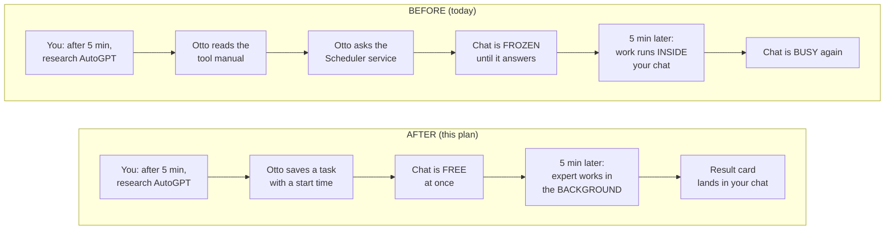
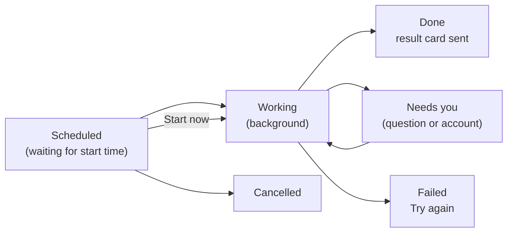
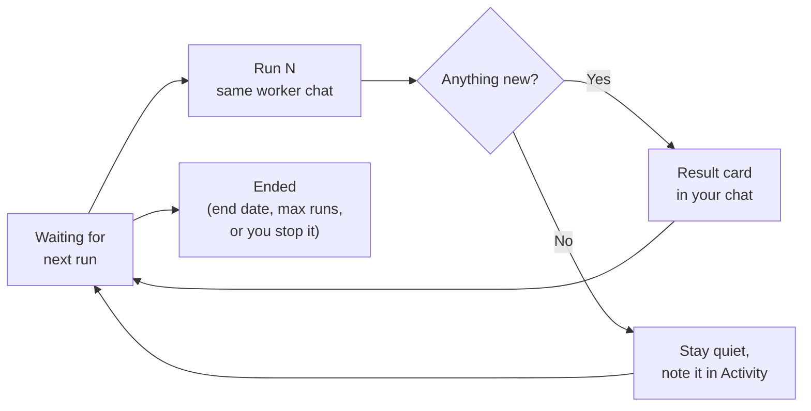

# Scheduled tasks: a task that starts later, or repeats

Status: plan agreed in outline, not built yet.

Example used throughout: you type **"after 5 min, research AutoGPT"**.

## 1. Before and after

| | Before (today) | After (this plan) |
|---|---|---|
| What gets saved | A timer in the Scheduler service | A task with a start time |
| Chat right after you ask | Can freeze (it did, 75 s+) | Free at once |
| Where the work runs | Inside your chat | Background, in the task's own worker chat |
| Chat while the work runs | Busy | Free |
| While waiting you see | A small note | Card with countdown, **Start now**, **Cancel** |
| On the board / in the brief | No | Yes |
| Change the time | No | Yes |
| Record, Stop, Try again | No | Yes |
| Chat busy at start time | Retried once, then dropped | Work starts anyway |
| Repeats | New run inside the chat each time | One task, one worker chat, many runs |

## 2. The design we are going with

Four choices, all settled:

| Question | Choice |
|---|---|
| Who starts a task when it is due? | The task row holds the start time. A small sweep every 15 to 30 s starts tasks that are due. No call to the Scheduler service when scheduling, so the chat cannot freeze. |
| Where does the work run? | In a worker chat of its own, in the background. The result comes back to the chat that asked as a result card. |
| Does everything timed become a task? | Work becomes a task. A plain reminder ("remind me at 5 to call Sam") stays a simple message in the chat, with no expert run. |
| Backend was down at start time? | Run it if only a little late. If hours late, ask **Start now or Cancel**. |

### One-off task

### Repeating task

One task. One worker chat. Each run is one more entry in the task's Activity.

Why one worker chat for repeats:

| | New chat every run | **One chat for the whole task** |
|---|---|---|
| Chats after "every 5 min for 3 days" | 864 | 1 |
| Remembers earlier runs | No | Yes |
| Cost per run | Low | Kept low by trimming (below) |

Keeping that one chat small: when it gets long, older runs are folded into a short running summary ("what I have found so far, what I already reported"). Each run reads the summary plus the last few runs, not the whole history.

### What carries the context

| Moment | What the expert gets |
|---|---|
| When you schedule | A brief Otto writes: goal, the facts from your chat it needs, what "done" looks like |
| When a one-off starts | That brief, plus a link back to the chat that asked |
| When a repeat runs | The brief + running summary + last few runs |
| When it reports | Only what changed since the last report |

## 3. Limits and guards

| Guard | Rule |
|---|---|
| Shortest delay for a one-off | 1 minute; anything shorter starts now |
| Shortest gap for a repeat | 15 minutes (can vary by plan) |
| A repeat must have an end | End date or max runs; default suggestion offered |
| Last run still going | Skip this run, do not pile up |
| Running at once | 5 tasks per user, as today |
| Scheduled tasks per user | Capped, with a clear message |
| Keeps failing | Paused after a few failures in a row; you are told |
| Nothing changed | No result card; one line in Activity |
| Many users at the same minute | Start times spread by a few seconds |
| Out of usage | Run waits for the reset, as today |

## 4. Every situation and what happens

### When you ask

| Situation | What happens |
|---|---|
| "In 30 seconds…" | Starts now |
| Time already passed | Otto asks, or starts now |
| "Tomorrow morning" | Uses your time zone; Otto says the exact time back |
| No time zone saved | Uses UTC and says so |
| Same request twice | Second one reuses the first task |
| "Every 2 minutes" | Otto offers the shortest allowed gap |
| Repeat with no end | Otto asks for an end or suggests one |
| Too many scheduled tasks | Refused with the limit and how to free a slot |
| No credits right now | Still scheduled; checked again at start |
| Vague goal | Otto asks one question before scheduling |

### While it waits

| Situation | What happens |
|---|---|
| You change the time | Updated; card and board follow |
| You cancel | Marked cancelled; nothing runs |
| You press Start now | Starts at once |
| You delete the chat that asked | Task stays; result goes to the board and a notification |
| The expert is removed or paused | Handed to Otto, or held and you are told |
| Backend restarts | Nothing lost; the start time is on the task |
| Account deleted | All scheduled tasks removed |

### When it is due

| Situation | What happens |
|---|---|
| Two servers pick it up at once | One wins, the other skips |
| Backend was down, a few minutes late | Runs |
| Backend was down, hours late | Asks Start now or Cancel |
| No credits / paywalled | Stays scheduled, shows why, starts after top-up |
| Daily or weekly limit hit | Moves to the reset time |
| 5 tasks already running | Waits in line, starts when a slot frees |
| A needed account is not connected | "Needs you" with a connect button |
| You already started it by hand | Skipped |
| Your chat is busy | Does not matter; work runs in the background |

### While it works

| Situation | What happens |
|---|---|
| Expert has a question, you are away | "Needs you" + notification; a repeat skips runs until answered |
| You stop it | Stops; a repeat asks "this run only, or all future runs?" |
| It fails | Try again; for a repeat, the next run still happens |
| Expert is blocked | Marked failed with the reason, never "done" |
| Run takes longer than the gap | Next run is skipped |

### When it reports

| Situation | What happens |
|---|---|
| Your chat is busy | Card waits until the chat is idle |
| Chat deleted or archived | Notification and board only |
| You are offline | Push or email; listed in the next morning brief |
| Repeat found nothing new | No card |
| Repeat found the same thing as last time | No card |
| 20 runs reported while you were away | One rolled-up card, newest first |

### Repeats only

| Situation | What happens |
|---|---|
| Clock change day | Runs at the same local time |
| End date reached | Marked ended; final summary card |
| Worker chat gets long | Older runs folded into the running summary |
| You edit the goal mid-way | Applies from the next run; noted in Activity |
| Pause and resume | Supported; missed runs are not replayed |
| You ask "what has it found so far?" | Otto reads the running summary |

## 5. Fifty real uses

"Once" = starts later one time. "Repeat" = runs on a rhythm.

### Developers

| # | What you say | Kind |
|---|---|---|
| 1 | "In 20 min, check if the deploy finished and tell me if errors went up" | Once |
| 2 | "Every hour today, check CI on main and tell me only if it breaks" | Repeat |
| 3 | "Tomorrow 9am, list PRs waiting on my review, oldest first" | Once |
| 4 | "Every morning, summarise new issues filed overnight" | Repeat |
| 5 | "In 2 hours, re-run the flaky test 10 times and report the fail rate" | Once |
| 6 | "Every Monday, list dependencies with new security advisories" | Repeat |
| 7 | "After the release tonight, draft the changelog from merged PRs" | Once |
| 8 | "Every 30 min for the next 4 hours, watch error logs for the new endpoint" | Repeat |

### Marketers

| # | What you say | Kind |
|---|---|---|
| 9 | "Tomorrow morning, pull yesterday's ad spend and cost per lead" | Once |
| 10 | "Every Friday, write the weekly performance summary" | Repeat |
| 11 | "In 3 days, check how the launch post did and suggest a follow-up" | Once |
| 12 | "Every morning, tell me if a competitor changed pricing or shipped something" | Repeat |
| 13 | "An hour before the webinar, draft the reminder email" | Once |
| 14 | "Every week, find 5 trending topics in our niche with post ideas" | Repeat |
| 15 | "On the 1st, build the content calendar for the month" | Repeat |

### Sales

| # | What you say | Kind |
|---|---|---|
| 16 | "In 3 days, if Acme has not replied, draft a follow-up" | Once |
| 17 | "Every morning, list deals with no activity for 7 days" | Repeat |
| 18 | "An hour before each call tomorrow, prepare a one-page brief on the company" | Once |
| 19 | "Every Monday, research 10 new leads that match our best customers" | Repeat |
| 20 | "Friday 4pm, summarise the week's pipeline changes" | Repeat |
| 21 | "In 2 weeks, check if the trial account is active and suggest a next step" | Once |

### Founders and operations

| # | What you say | Kind |
|---|---|---|
| 22 | "Every morning at 8, brief me on signups, revenue and churn" | Repeat |
| 23 | "Sunday night, plan my week from my calendar and open tasks" | Repeat |
| 24 | "In 1 hour, turn today's meeting notes into action items with owners" | Once |
| 25 | "Before the board meeting on the 20th, draft the update from last month's numbers" | Once |
| 26 | "Every week, check which vendor contracts renew in the next 30 days" | Repeat |
| 27 | "Tomorrow, research three tools for payroll and compare them" | Once |

### Customer support

| # | What you say | Kind |
|---|---|---|
| 28 | "Every 2 hours, flag tickets waiting more than a day" | Repeat |
| 29 | "Every evening, summarise today's top complaints" | Repeat |
| 30 | "In 24 hours, check whether the customer confirmed the fix worked" | Once |
| 31 | "Every Monday, list help articles that tickets say are out of date" | Repeat |
| 32 | "After the outage is resolved, draft the apology email to affected users" | Once |

### Finance

| # | What you say | Kind |
|---|---|---|
| 33 | "On the 1st, list invoices overdue by more than 30 days and draft reminders" | Repeat |
| 34 | "Every Friday, reconcile this week's card spend against budgets" | Repeat |
| 35 | "Three days before month end, list what is missing for close" | Repeat |
| 36 | "Tomorrow, check if the wire from the client arrived" | Once |
| 37 | "Every morning, tell me if any subscription charge is higher than last month" | Repeat |

### Recruiting and people

| # | What you say | Kind |
|---|---|---|
| 38 | "Every morning, shortlist new applicants for the designer role" | Repeat |
| 39 | "Two days after each interview, draft the follow-up to the candidate" | Once |
| 40 | "A week before each start date, prepare the onboarding checklist" | Once |
| 41 | "Every quarter, remind me which reviews are due and draft the agenda" | Repeat |

### Writers and creators

| # | What you say | Kind |
|---|---|---|
| 42 | "Tomorrow at 7, outline the newsletter from this week's saved links" | Once |
| 43 | "Every Tuesday, draft three post ideas from what did well last week" | Repeat |
| 44 | "In 2 days, reread the draft with fresh eyes and list weak sections" | Once |
| 45 | "Every day for 2 weeks, check comments on the video and summarise questions" | Repeat |

### Personal

| # | What you say | Kind |
|---|---|---|
| 46 | "Every morning for a week, check flight prices to Tokyo and tell me if they drop" | Repeat |
| 47 | "A week before the trip, build the packing and bookings checklist" | Once |
| 48 | "On the 25th, list bills due before month end" | Repeat |
| 49 | "Every Sunday, plan meals for the week and write the shopping list" | Repeat |
| 50 | "In 6 months, remind me to renew my passport and list what I need" | Once |

What these have in common: most repeats should **stay quiet unless something changed** (2, 8, 12, 28, 37, 46). That is why "no news, no card" is a core rule and not a nice-to-have.

## 6. Quick fixes worth doing first

Small changes that stop the freeze for plain reminders too:

1. Limit the Scheduler call to about 10 s instead of 300 s; say so plainly if it fails.
2. Make Otto end its turn after scheduling.
3. Make the follow-up tool always available, so Otto skips the "read the manual" step.

## 7. Build order

1. Quick fixes above.
2. Start time on the task + sweep that starts due tasks (one-off).
3. Scheduled card, board badge, Start now, Cancel, change time.
4. Handling for no credits, limits, missed start.
5. Brief shows what starts today.
6. Repeating tasks: one worker chat, running summary, "no news, no card", guards from section 3.
7. Eval cases for the situations in section 4.

## 8. How you will test it

- "In 2 minutes research X": chat frees at once, card counts down, task starts, result card arrives.
- Same, but keep chatting through the start time: work still starts.
- Cancel before start. Start now before start. Change the time.
- Restart the backend during the wait: task still starts.
- Schedule, then delete the chat: task still runs, result on the board.
- "Every 15 min for an hour, check X": one task, one worker chat, four runs, cards only when something changed.
