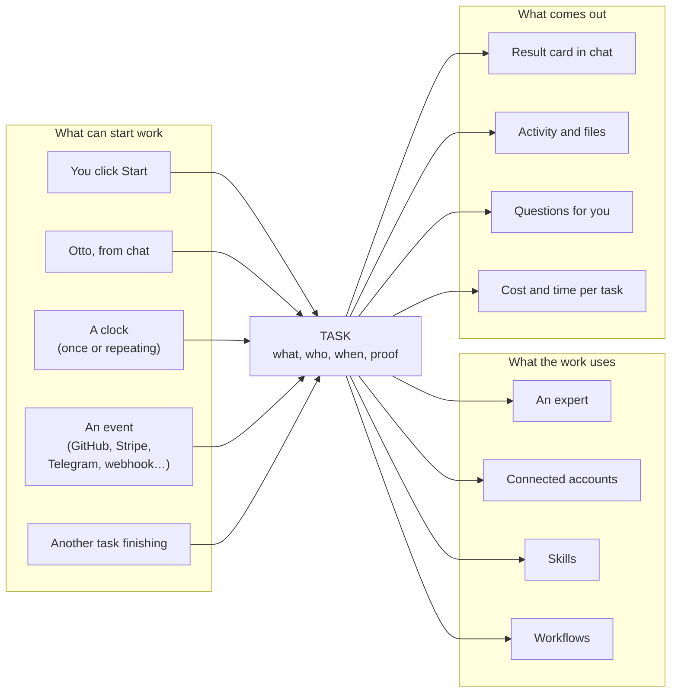

# The task as the centre: today vs after

Status: direction for the prototype. Companion to `scheduled-tasks-design.md`.

## 1. The idea in one picture

## 2. What the system can do today

| Starter | Today | Where it shows |
|---|---|---|
| You ask in chat, now | Yes: Otto answers, or hands work to an expert in the background | Chat, task board |
| A clock, once ("in 5 min") | Yes, as a follow-up. Runs inside your chat. Can freeze the chat. No record. | A small note in chat; Library → Follow-ups |
| A clock, repeating ("every morning") | Yes, as a follow-up or an expert routine. Runs inside a chat each time. | Library → Follow-ups; the expert's page |
| An event (GitHub, Stripe, Telegram, Airtable, generic webhook) | Yes, but it can only start a **workflow** you built in the builder | Library → the workflow's runs |
| An event from Gmail, Slack, Discord, Calendar | No trigger. Only by checking on a clock. | — |
| One piece of work starting another | No | — |

The problem is not that little is possible. It is that each starter lives in a different place, behaves differently, and leaves no common record.

## 3. What changes after tasks

| | Today | After |
|---|---|---|
| Where work lives | Inside chat sessions, workflows, follow-ups, routines | In a task, whatever started it |
| Starting work later | Follow-up tool, can freeze chat | "Start this task at 10:05" |
| Repeating work | New run inside a chat each time | One task, many runs, one record |
| An event starting work | Only a workflow built by hand | "When this happens, start this task", said in chat |
| Seeing what is set up | Three different pages | One board |
| Stopping or changing it | Different per kind; some delete-only | Same controls everywhere |
| Proof of what was done | Depends | Always: Activity, files, result |
| Cost of a piece of work | Cannot tell | Counted per task |
| Chat while work runs | Often busy | Free |
| Quiet when nothing happened | No | Yes: no news, no card |

Old services stay in the prototype. They get a small change so what they start is a task.

## 4. How it looks for the user

**In chat.** You say what you want in one sentence. Otto replies with a card:

- Start later: "Scheduled · starts 10:05" with **Start now** and **Cancel**.
- Repeating: "Every weekday 8:00 · next run tomorrow" with **Pause**.
- Event: "Watching · starts when a PR is opened on acme/web" with **Pause**.

Your chat is free straight away. Results come back as cards in the same chat.

**On the board.** One place for everything, grouped by state:

| Group | What is in it |
|---|---|
| Needs you | Tasks waiting on your answer or an account |
| Working | Running now |
| Scheduled | Will start at a time, with countdown |
| Watching | Waiting for an event, or repeating on a rhythm |
| Done | Finished, with results |

**On the task page.**

- "Starts when…" line: the time, the rhythm or the event.
- Runs: each time it ran, when, how long, what it cost, whether it found anything.
- Activity: what the expert did, which account and skill it used.
- Result and files.
- Stop, Try again, Pause, change time.

**In the morning brief.** What finished overnight, what needs you, what starts today, what the watching tasks caught.

## 5. Fifty examples: today vs after

"Today" column:

- **Clunky** = possible as a follow-up or routine: runs inside your chat, no record, hard to manage.
- **Build it** = possible only by building a workflow in the builder first.
- **No** = cannot be done.

"After" column says what starts the task. "Check" means it looks on a rhythm (about every 15 minutes) because that service has no instant trigger yet.

### A clock, once

| # | You say | Today | After |
|---|---|---|---|
| 1 | "In 5 minutes, research AutoGPT's competitors" | Clunky | Task, starts at a time |
| 2 | "Tomorrow 9am, list PRs waiting on my review" | Clunky | Task, starts at a time |
| 3 | "In 3 days, if Acme hasn't replied, draft a follow-up" | Clunky | Task, starts at a time |
| 4 | "An hour before the webinar, draft the reminder email" | Clunky | Task, starts at a time |
| 5 | "After lunch, turn my meeting notes into action items" | Clunky | Task, starts at a time |
| 6 | "In 2 weeks, check if the trial account is active" | Clunky | Task, starts at a time |
| 7 | "Friday 4pm, summarise this week's pipeline" | Clunky | Task, starts at a time |
| 8 | "In 6 months, remind me to renew my passport with what I need" | Clunky | Task, starts at a time |

### A clock, repeating

| # | You say | Today | After |
|---|---|---|---|
| 9 | "Every morning at 8, brief me on signups and revenue" | Clunky | One task, runs daily |
| 10 | "Every Monday, find 10 leads like our best customers" | Clunky | One task, runs weekly |
| 11 | "Every hour today, check CI and tell me only if it breaks" | Clunky, reports every time | One task, quiet unless it breaks |
| 12 | "Every Friday, write the weekly marketing summary" | Clunky | One task, runs weekly |
| 13 | "Every morning, list deals with no activity for 7 days" | Clunky | One task, runs daily |
| 14 | "Every evening, summarise today's top support complaints" | Clunky | One task, runs daily |
| 15 | "On the 1st, list invoices overdue by 30 days and draft reminders" | Clunky | One task, runs monthly |
| 16 | "Every Sunday, plan my week from calendar and open tasks" | Clunky | One task, runs weekly |
| 17 | "Every day for a week, check flight prices to Tokyo, tell me if they drop" | Clunky, reports every time | One task, quiet unless they drop |
| 18 | "Every week, list contracts renewing in the next 30 days" | Clunky | One task, runs weekly |
| 19 | "Every morning, shortlist new applicants for the designer role" | Clunky | One task, runs daily |
| 20 | "Every Tuesday, draft three post ideas from last week's best posts" | Clunky | One task, runs weekly |

### An event, where a trigger already exists

| # | You say | Today | After |
|---|---|---|---|
| 21 | "When a PR is opened on my repo, review it and tell me" | Build it | Task, starts on GitHub event |
| 22 | "When an issue is labelled bug, try to reproduce it and report" | Build it | Task, starts on GitHub event |
| 23 | "When someone pushes to main, check if docs need updating" | Build it | Task, starts on GitHub event |
| 24 | "When a release is published, draft the announcement" | Build it | Task, starts on GitHub event |
| 25 | "When CI fails on main, find the likely cause" | Build it | Task, starts on GitHub event |
| 26 | "When a customer's subscription is cancelled, draft a win-back note" | Build it | Task, starts on Stripe event |
| 27 | "When a payment fails, check the account and draft a reminder" | Build it | Task, starts on Stripe event |
| 28 | "When a new customer subscribes, research their company for onboarding" | Build it | Task, starts on Stripe event |
| 29 | "When someone messages our Telegram bot, summarise and tell me" | Build it | Task, starts on Telegram event |
| 30 | "When a Telegram message asks for pricing, draft the reply for me to approve" | Build it | Task, starts on Telegram event |
| 31 | "When a new row is added to the leads table, research the lead" | Build it | Task, starts on Airtable event |
| 32 | "When a row's status changes to Won, prepare the kickoff doc" | Build it | Task, starts on Airtable event |
| 33 | "When our signup form is submitted, qualify the lead and tell me if it is hot" | Build it | Task, starts on webhook |
| 34 | "When our monitoring tool calls this URL, look into the alert and summarise" | Build it | Task, starts on webhook |

### An event, where there is no trigger yet

| # | You say | Today | After |
|---|---|---|---|
| 35 | "When Nick emails me, tell me straight away" | No | Task, check; instant once a Gmail trigger exists |
| 36 | "When a client emails with an invoice, file it and add it to the sheet" | No | Task, check |
| 37 | "When someone mentions pricing in our Slack channel, summarise it for me" | No | Task, check |
| 38 | "When a meeting is added to my calendar with someone new, research them" | No | Task, check |
| 39 | "When a competitor changes their pricing page, tell me what changed" | No | Task, check |
| 40 | "When our product is mentioned on Hacker News, draft a reply" | No | Task, check |
| 41 | "When a doc in the shared folder changes, summarise the edits" | No | Task, check |
| 42 | "When a support ticket has waited a day, flag it" | No | Task, check |
| 43 | "When a stock I follow moves 5 percent, tell me why" | No | Task, check |
| 44 | "When Nick posts in our Discord channel, tell me" | No | Task, check (channel, not personal DM) |

### One task starting another

| # | You say | Today | After |
|---|---|---|---|
| 45 | "When the research task finishes, start drafting the blog post from it" | No | Task, starts when another finishes |
| 46 | "When the lead research is done, draft the outreach email for my approval" | No | Task, starts when another finishes |
| 47 | "When the weekly report is ready, turn it into slides" | No | Task, starts when another finishes |
| 48 | "If the deploy check finds errors, start the rollback checklist" | No | Task, starts when another fails |
| 49 | "When I approve the draft, schedule the post for tomorrow 9am" | No | Task, starts on your answer |
| 50 | "When the candidate shortlist is ready, book intro calls with the top three" | No | Task, starts when another finishes |

### What the fifty show

| Group | Today | After |
|---|---|---|
| Clock, once (1–8) | Possible but clunky | Clean |
| Clock, repeating (9–20) | Possible but clunky, noisy | Clean, quiet when nothing changed |
| Event with a trigger (21–34) | Only by building a workflow | One sentence in chat |
| Event without a trigger (35–44) | Not possible | Works by checking; instant as triggers are added |
| Task starting a task (45–50) | Not possible | New |

## 6. "Anything a human could do": honest limits

Tasks decide **when** work starts and **keep track** of it. Whether the expert can actually do the work still depends on:

| Limit | What it means |
|---|---|
| Access | It needs a connected account or a tool for the thing (email, repo, calendar, a website) |
| Instant events | Only services with a trigger are instant. Others are checked on a rhythm. |
| Personal DMs | Some services (Discord) do not let any app read them |
| Judgment calls | Sending, paying, deleting: the task should stop and ask you first |
| Cost | Every run costs. Checks should be cheap and stay quiet when nothing changed. |

## 7. Build order for the prototype

1. Start later, once (in flight).
2. One task, many runs (repeating).
3. An event starts a task: begin with GitHub or the generic webhook.
4. A task starts another task.
5. Board groups: Scheduled, Watching.
