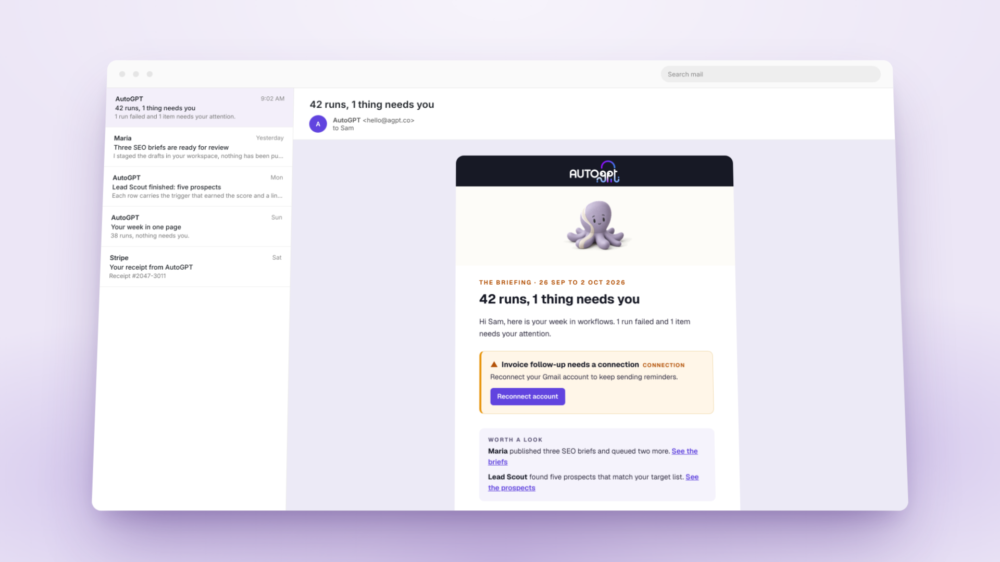

# A cleaner chat that shows its work, clickable answers, emails worth opening

*August 21 – September 4, 2026*

**Platform versions:** `v0.7.2` · `v0.7.3` · `v0.7.4`

## The chat shows its work, and gets out of your way

Otto's tool activity now renders as one compact chain of steps: each step shows a live status, the icon of the service it used, and a result card you can expand, while interactive steps like questions and connection prompts stay in the flow. Around it the chat was restyled: a small floating identity chip instead of a header band, a single-row pill composer that stacks when your text wraps, neutral bubbles with actions on hover, and the sidebar folds away while the artifacts panel is open. When a long conversation needs condensing you see a live progress card with the real numbers instead of a silent pause. [#13773](https://github.com/Significant-Gravitas/AutoGPT/pull/13773) [#14164](https://github.com/Significant-Gravitas/AutoGPT/pull/14164) [#14158](https://github.com/Significant-Gravitas/AutoGPT/pull/14158) [#14239](https://github.com/Significant-Gravitas/AutoGPT/pull/14239) [#14304](https://github.com/Significant-Gravitas/AutoGPT/pull/14304) [#14143](https://github.com/Significant-Gravitas/AutoGPT/pull/14143)

## Answer with a click

When Otto needs a decision it now offers real options you can click, with a "Type something…" escape hatch when none fit. Blocking questions are always asked this way, so they show up in Home's needs-attention list instead of being buried in prose at the end of a reply. [#14156](https://github.com/Significant-Gravitas/AutoGPT/pull/14156)

## Emails that answer one question

The run report and the weekly summary are retired. In their place are four kinds of email, each answering either "do I need to do something?" or "what got done for me?": a Briefing of what your workflows and experts did, an Alert when something needs you, a Verdict when a piece of work is finished, and an Ops note when something is broken. Every one links back to the platform. [#14003](https://github.com/Significant-Gravitas/AutoGPT/pull/14003)

<figure><figcaption>
Briefing, Alert, Verdict and Ops: the four emails the platform sends
</figcaption></figure>

## See and control what AutoGPT remembers

Settings → Memory lists the recent things Otto has learned about you, lets you forget any of them with one click, and can erase everything in a scope behind a typed confirmation. Ask for a summary and a fresh chat opens with everything Otto knows about you. [#14071](https://github.com/Significant-Gravitas/AutoGPT/pull/14071)

✨ Improvements

- **GitHub notification blocks:** list, mark and triage the notifications in your GitHub inbox, and the pull request block returns the full request object. ([#13634](https://github.com/Significant-Gravitas/AutoGPT/pull/13634), [#14295](https://github.com/Significant-Gravitas/AutoGPT/pull/14295))
- **Pay a merchant from a workflow with Stripe Link:** a device-code sign-in gives a workflow a one-time payment credential from your Link wallet, and you approve every spend. ([#14062](https://github.com/Significant-Gravitas/AutoGPT/pull/14062), [#14063](https://github.com/Significant-Gravitas/AutoGPT/pull/14063), [#14066](https://github.com/Significant-Gravitas/AutoGPT/pull/14066))
- **Stripe subscription triggers:** start a workflow on real subscription events straight from Stripe. ([#13435](https://github.com/Significant-Gravitas/AutoGPT/pull/13435))
- **DataForB2B blocks** search and enrich companies and professional profiles. ([#13383](https://github.com/Significant-Gravitas/AutoGPT/pull/13383))
- **All Quiet blocks** open and manage incidents. ([#14053](https://github.com/Significant-Gravitas/AutoGPT/pull/14053))
- **The Fast and Thinking toggle is gone.** Otto picks the engine a deployment can run; you no longer have to. ([#14083](https://github.com/Significant-Gravitas/AutoGPT/pull/14083))
- **Skill descriptions can be 1,024 characters.** ([#14024](https://github.com/Significant-Gravitas/AutoGPT/pull/14024))
- **Local installs get Ornith 1.5 as the recommended model,** with its full context window. ([#14188](https://github.com/Significant-Gravitas/AutoGPT/pull/14188))

🎨 UI/UX Improvements

- **Integrations in the + menu opens the connect dialog,** so you add a new service instead of landing on the list of ones you already have. ([#14001](https://github.com/Significant-Gravitas/AutoGPT/pull/14001))
- **The composer no longer flickers** between its row and stacked layouts, or while you type in an empty session. ([#14250](https://github.com/Significant-Gravitas/AutoGPT/pull/14250), [#14270](https://github.com/Significant-Gravitas/AutoGPT/pull/14270))
- **Budgets show in dollars** and run cards no longer get clipped by their tab. ([#14073](https://github.com/Significant-Gravitas/AutoGPT/pull/14073))
- **"Your workflows"** is the heading for the workflows you can hand to an expert, sized like its neighbors. ([#14142](https://github.com/Significant-Gravitas/AutoGPT/pull/14142))

🐛 Bug Fixes

- **Google sign-ups no longer land in a broken account** when the platform profile was missing. ([#14147](https://github.com/Significant-Gravitas/AutoGPT/pull/14147))
- **Completing a Connect card actually connects** the integration and continues the turn. ([#14316](https://github.com/Significant-Gravitas/AutoGPT/pull/14316))
- **Workflows with nested workflows ask for every connection up front** instead of failing one level down. ([#14076](https://github.com/Significant-Gravitas/AutoGPT/pull/14076))
- **Connecting an MCP server through Stripe and similar sign-in pages** no longer fails with "Sign-in window was closed". ([#14141](https://github.com/Significant-Gravitas/AutoGPT/pull/14141))
- **The Connect Social Media Accounts button** appears wherever a social credential is needed: chat cards and run forms as well as the Builder. ([#14014](https://github.com/Significant-Gravitas/AutoGPT/pull/14014))
- **A removed connection is reported** instead of being swapped silently for another one. ([#14059](https://github.com/Significant-Gravitas/AutoGPT/pull/14059))
- **A run your plan does not allow is marked failed** with the reason, instead of completed. ([#14060](https://github.com/Significant-Gravitas/AutoGPT/pull/14060))
- **Provider failures are reported from the engine that ran the turn.** ([#14103](https://github.com/Significant-Gravitas/AutoGPT/pull/14103))
- **Discord and Telegram bots:** seven delivery and formatting fixes across the adapters. ([#14097](https://github.com/Significant-Gravitas/AutoGPT/pull/14097))
- **Running out of credits shows a plain message** instead of an analysis attempt. ([#12614](https://github.com/Significant-Gravitas/AutoGPT/pull/12614))
- **The single container stops cleanly** inside Docker's default timeout. ([#14077](https://github.com/Significant-Gravitas/AutoGPT/pull/14077))

