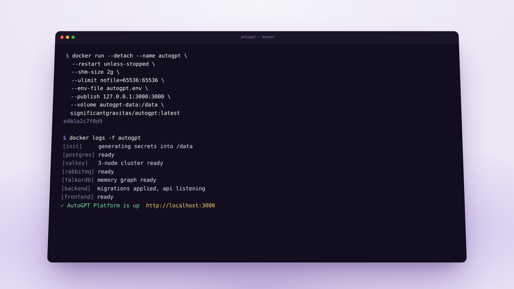

# Paste screenshots into chat, talk through onboarding, self-host in one container

*July 29 – August 13, 2026*

**Platform versions:** `v0.6.70` · `v0.7.0` · `v0.7.1`

## Paste a screenshot straight into the chat

Copy an image anywhere, press Cmd+V or Ctrl+V in the composer, and it attaches. No more saving a screenshot to disk and picking it from the file dialog. [#13645](https://github.com/Significant-Gravitas/AutoGPT/pull/13645)

## Tell Otto about your work out loud

Onboarding no longer asks you to pick pain points from a list. You talk for a minute or two about what you do all day; the recording is saved locally as you speak so nothing is lost, and the transcript shapes your first screen: a personal greeting, starter prompts written for your work, and a short list of tools worth connecting, picked from what you said. [#13764](https://github.com/Significant-Gravitas/AutoGPT/pull/13764) [#13785](https://github.com/Significant-Gravitas/AutoGPT/pull/13785) [#13792](https://github.com/Significant-Gravitas/AutoGPT/pull/13792)

## Run the whole platform from one container

Self-hosting is now one `docker run`. The single-container image bundles the frontend, the backend services, PostgreSQL, Valkey, RabbitMQ, FalkorDB memory and nginx, generates its own secrets on first boot, keeps everything under `/data`, and recovers itself if a service dies. Multi-architecture images are published to Docker Hub. [#13758](https://github.com/Significant-Gravitas/AutoGPT/pull/13758) [#13994](https://github.com/Significant-Gravitas/AutoGPT/pull/13994) [#13757](https://github.com/Significant-Gravitas/AutoGPT/pull/13757)

<figure><figcaption>
One image, one command, the full platform
</figcaption></figure>

## Claude Sonnet 5, and a model catalog that keeps itself tidy

Claude Sonnet 5 is available in LLM blocks, with the Claude 5 tokenizer so token counts stay right. Kimi K3 arrived with it. Behind both is a single model catalog: every model's pricing, availability and routing lives in one place, and retiring a model migrates the workflows that used it instead of breaking them. [#13629](https://github.com/Significant-Gravitas/AutoGPT/pull/13629) [#13627](https://github.com/Significant-Gravitas/AutoGPT/pull/13627)

✨ Improvements

- **Sign-in runs on Better Auth.** The platform no longer depends on Supabase for accounts. Google sign-in keeps working, and self-hosted installs drop a whole sidecar stack. ([#13330](https://github.com/Significant-Gravitas/AutoGPT/pull/13330))
- **Tavily blocks:** search, extract, crawl and map the web with Tavily's API. ([#13499](https://github.com/Significant-Gravitas/AutoGPT/pull/13499))
- **Sort your workflows by "Most recently ran,"** so the one you just used is at the top. ([#13666](https://github.com/Significant-Gravitas/AutoGPT/pull/13666))
- **First-visit cards on the Workflows, Marketplace and Build pages** say what the page is for and offer one way to start. ([#13805](https://github.com/Significant-Gravitas/AutoGPT/pull/13805))
- **Saved cards at checkout:** upgrading or resubscribing offers the card Stripe already has for you. ([#13743](https://github.com/Significant-Gravitas/AutoGPT/pull/13743))
- **Bots: the install flow finishes where it started.** After connecting a chat platform you land back on Settings → Bots, a half-finished install shows as pending, and each platform is called by its own name (servers, workspaces, groups). ([#13999](https://github.com/Significant-Gravitas/AutoGPT/pull/13999))
- **Swapping a trigger tells you which webhook presets were skipped** when you activate a new workflow version. ([#13682](https://github.com/Significant-Gravitas/AutoGPT/pull/13682))
- **Self-hosters can point transcription at any OpenAI-compatible endpoint.** ([#13500](https://github.com/Significant-Gravitas/AutoGPT/pull/13500))

🎨 UI/UX Improvements

- **New icons across the app:** Phosphor is replaced by Hugeicons with a consistent rounded stroke. ([#13751](https://github.com/Significant-Gravitas/AutoGPT/pull/13751))
- **A compact wallet popover** built for the sidebar: balance, top up and auto-refill without the oversized panel. ([#13699](https://github.com/Significant-Gravitas/AutoGPT/pull/13699))
- **One avatar fallback everywhere:** the account menu uses the same marble avatar as profiles and the Marketplace. ([#13775](https://github.com/Significant-Gravitas/AutoGPT/pull/13775))
- **The Build canvas gets its full width back** in the sidebar layout. ([#13742](https://github.com/Significant-Gravitas/AutoGPT/pull/13742))
- **File previews stay inside the window** when the Files drawer and a preview are both open. ([#13797](https://github.com/Significant-Gravitas/AutoGPT/pull/13797))
- **Image and logo uploads say when a file is too large,** and what the limit is. ([#13684](https://github.com/Significant-Gravitas/AutoGPT/pull/13684))
- **The search dialog describes itself to screen readers.** ([#13675](https://github.com/Significant-Gravitas/AutoGPT/pull/13675))

🐛 Bug Fixes

- **Workflows added from the Marketplace keep their listing name, description and image** instead of the creator's working title. ([#13680](https://github.com/Significant-Gravitas/AutoGPT/pull/13680))
- **Otto no longer drops a workflow mid-edit** when the editing tools receive it by reference. ([#13441](https://github.com/Significant-Gravitas/AutoGPT/pull/13441))
- **The Triggers tab finds every preset,** including ones past the first page. ([#13681](https://github.com/Significant-Gravitas/AutoGPT/pull/13681))
- **Memory keeps up under load:** queued memory writes retry instead of being dropped. ([#13686](https://github.com/Significant-Gravitas/AutoGPT/pull/13686))
- **Forgetting a memory explains why it could not** instead of failing silently. ([#13672](https://github.com/Significant-Gravitas/AutoGPT/pull/13672))
- **Webhooks reject a request whose URL names a different provider** than the stored webhook. ([#13559](https://github.com/Significant-Gravitas/AutoGPT/pull/13559))
- **Old /profile links redirect to Settings** on both layouts, keeping their anchors. ([#14000](https://github.com/Significant-Gravitas/AutoGPT/pull/14000))
- **Dropdowns with an empty option no longer crash a form.** ([#12495](https://github.com/Significant-Gravitas/AutoGPT/pull/12495))
- **The global search shortcut** no longer errors with some input methods. ([#13472](https://github.com/Significant-Gravitas/AutoGPT/pull/13472))
- **A creator page that does not exist returns a proper not-found page.** ([#13677](https://github.com/Significant-Gravitas/AutoGPT/pull/13677))
- **Resuming a chat** no longer errors before the chat state is ready. ([#13766](https://github.com/Significant-Gravitas/AutoGPT/pull/13766))
- **Browser translation extensions** no longer break the tour page. ([#13767](https://github.com/Significant-Gravitas/AutoGPT/pull/13767))

