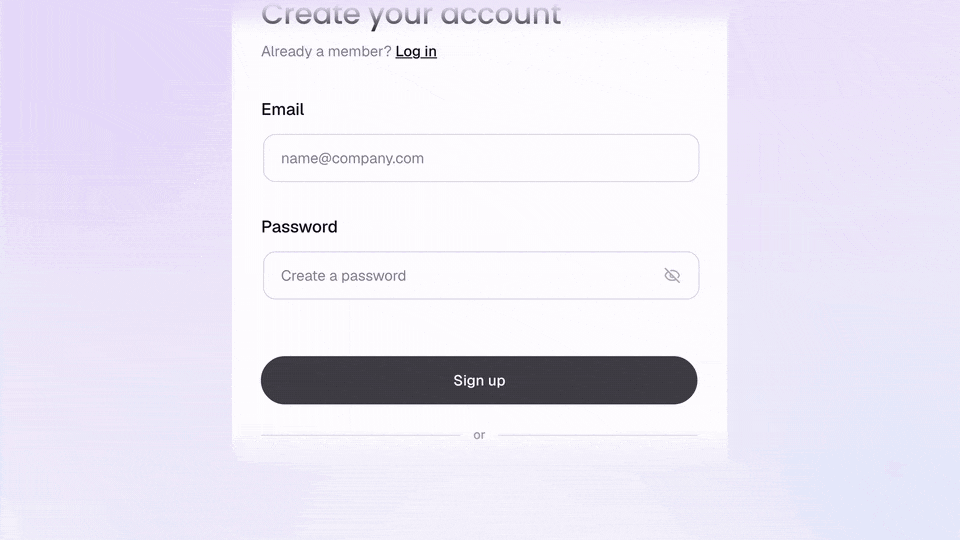
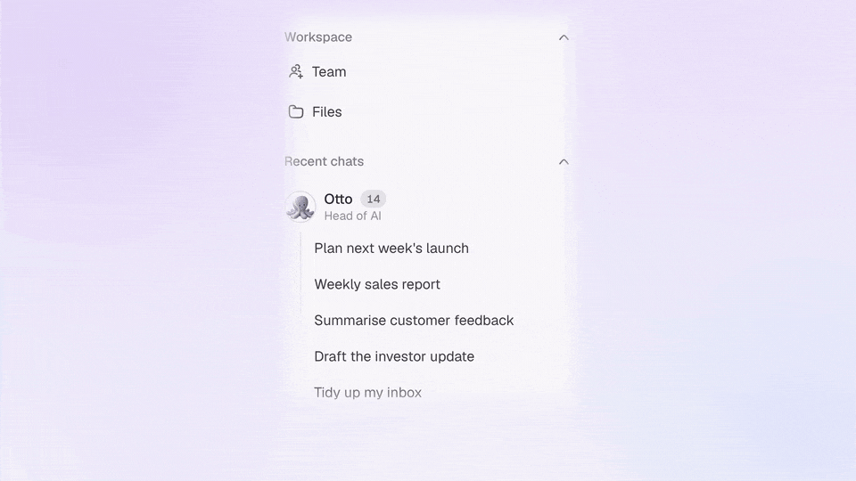
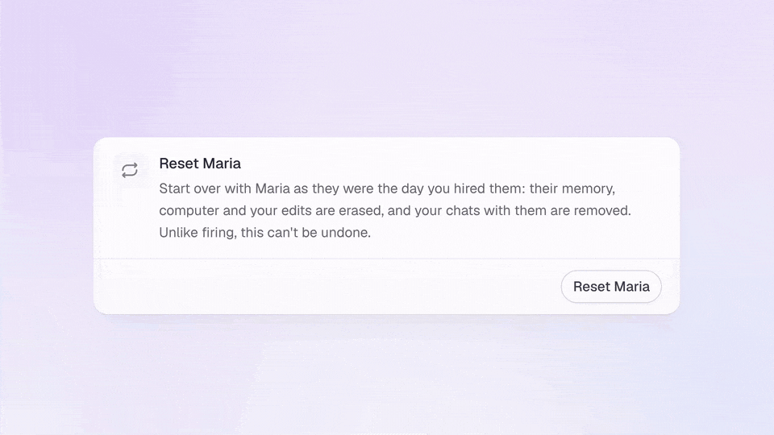
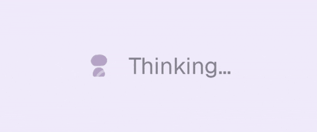

# Sign up in fewer steps, every Expert's chats in the sidebar, and reset an Expert

*November 15 – November 19, 2026*

**Platform versions:** `v0.11.3` · `v0.12.0`

## Sign up in fewer steps

Signing up asks for your password once, with a button to show it, and the sign-up and login pages appear as soon as they load. After you sign up, setup no longer sits on "Loading your setup…": the first step's frame shows while it gets ready. You can also sign up and log in with Microsoft. Sign up with Google and onboarding opens on **Also connect Gmail, Drive and Calendar?**, which says what each one lets Otto do and connects all three on one Google screen. Leave one unticked there and it shows as needing your permission, with **Allow** to add it later. [#16829](https://github.com/Significant-Gravitas/AutoGPT/pull/16829) [#16831](https://github.com/Significant-Gravitas/AutoGPT/pull/16831) [#16968](https://github.com/Significant-Gravitas/AutoGPT/pull/16968) [#16845](https://github.com/Significant-Gravitas/AutoGPT/pull/16845) [#16877](https://github.com/Significant-Gravitas/AutoGPT/pull/16877) [#16269](https://github.com/Significant-Gravitas/AutoGPT/pull/16269)

<figure><figcaption>
One password field, then Gmail, Drive and Calendar in one step
</figcaption></figure>

## Every Expert's chats in the sidebar

**Recent chats** in the sidebar now shows up to 30 chats, grouped by who you talked to: Otto and each of your Experts. Every group opens on its newest chats and shows its real count, and **Show more** under a group loads 10 more of that Expert's chats. A group you close stays closed on that device. [#16791](https://github.com/Significant-Gravitas/AutoGPT/pull/16791)

<figure><figcaption>
Every group open, with its real count
</figcaption></figure>

## Reset an Expert to day one

An Expert's **Settings** tab has a new **Reset** section. Before you confirm, it lists what is erased (what the Expert remembers, its computer and your edits), what is removed (your chats with it) and what is kept (its skills, workflows, connections and budget). Afterwards, open a chat with them and they introduce themselves again. Unlike firing, a reset can't be undone. [#16688](https://github.com/Significant-Gravitas/AutoGPT/pull/16688)

<figure><figcaption>
See what's erased and what's kept before you confirm
</figcaption></figure>

## A thinking figure in your team's colors

While Otto or an Expert works on a reply, the figure beside **Thinking…** is now a small stone Expert whose head changes shape with each hop, in the color of whoever is answering: Otto's lavender, or the Expert's own, like Maria's terracotta. **Thinking…** also stays up until the reply starts, instead of disappearing for a few seconds. [#16711](https://github.com/Significant-Gravitas/AutoGPT/pull/16711) [#17038](https://github.com/Significant-Gravitas/AutoGPT/pull/17038)

<figure><figcaption>
Otto's lavender, then Maria's terracotta
</figcaption></figure>

✨ Improvements

- **Send again:** when the chat can't confirm your message arrived, its notice has a **Send again** button that sends the same message and files, without sending it twice. ([#17041](https://github.com/Significant-Gravitas/AutoGPT/pull/17041), [#16962](https://github.com/Significant-Gravitas/AutoGPT/pull/16962))
- **Pages catch up after a dropped connection:** your Library, run history, Activity and chats show a run that finished meanwhile as finished. ([#16898](https://github.com/Significant-Gravitas/AutoGPT/pull/16898), [#16915](https://github.com/Significant-Gravitas/AutoGPT/pull/16915), [#16932](https://github.com/Significant-Gravitas/AutoGPT/pull/16932))
- **Schedules during an update:** the Library and workflow pages say your schedules are briefly unavailable instead of showing none, and trying again after a slow save no longer makes a second schedule. ([#16937](https://github.com/Significant-Gravitas/AutoGPT/pull/16937), [#16904](https://github.com/Significant-Gravitas/AutoGPT/pull/16904))
- **Experts you hire in Otto's chat introduce themselves** in their own chat, like a hire from their page. ([#16687](https://github.com/Significant-Gravitas/AutoGPT/pull/16687))
- **Delete your account yourself** from **Settings › Account**. ([#16793](https://github.com/Significant-Gravitas/AutoGPT/pull/16793))
- **Connected accounts are named by their email** when you pick one, so two Google accounts are easy to tell apart. ([#16708](https://github.com/Significant-Gravitas/AutoGPT/pull/16708))
- **The wallet updates its balance** after a run finishes or a reply ends. ([#16531](https://github.com/Significant-Gravitas/AutoGPT/pull/16531))
- **Otto says when a website turns it away** and uses another source. ([#16539](https://github.com/Significant-Gravitas/AutoGPT/pull/16539))
- **New models:** Gemini 4 Neon, Gemini 4 Hydrogen, Gemini 4 Carbon, GPT-6.2 Astra, GPT-6.2 Sol and Qwen 4 Max. ([#17023](https://github.com/Significant-Gravitas/AutoGPT/pull/17023), [#16792](https://github.com/Significant-Gravitas/AutoGPT/pull/16792), [#16741](https://github.com/Significant-Gravitas/AutoGPT/pull/16741), [#16870](https://github.com/Significant-Gravitas/AutoGPT/pull/16870), [#16899](https://github.com/Significant-Gravitas/AutoGPT/pull/16899), [#16836](https://github.com/Significant-Gravitas/AutoGPT/pull/16836))
- **New apps to connect:** AnySearch, Supabase, Klaviyo, AI/ML API and CompanyEnrich are in **Connect a service**, and Otto now finds the custom tool servers you connected by URL. ([#16913](https://github.com/Significant-Gravitas/AutoGPT/pull/16913), [#16659](https://github.com/Significant-Gravitas/AutoGPT/pull/16659), [#15202](https://github.com/Significant-Gravitas/AutoGPT/pull/15202), [#16771](https://github.com/Significant-Gravitas/AutoGPT/pull/16771), [#16447](https://github.com/Significant-Gravitas/AutoGPT/pull/16447), [#15168](https://github.com/Significant-Gravitas/AutoGPT/pull/15168))

🎨 UI/UX Improvements

- **Otto's card on the Team page says its numbers are the team's totals.** ([#16387](https://github.com/Significant-Gravitas/AutoGPT/pull/16387))
- **Ctrl/Cmd+Z in a builder text field undoes your typing,** not the last change to the workflow. ([#17035](https://github.com/Significant-Gravitas/AutoGPT/pull/17035))
- **A block's input error is one short line,** such as `items: expected array, got string`, instead of a wall of text. ([#17000](https://github.com/Significant-Gravitas/AutoGPT/pull/17000))

🐛 Bug Fixes

- **A trial whose first charge failed shows Pay now again** on the paywall and in Billing. ([#16834](https://github.com/Significant-Gravitas/AutoGPT/pull/16834))
- **An account whose trial has no card can choose a plan** instead of getting a checkout error. ([#16709](https://github.com/Significant-Gravitas/AutoGPT/pull/16709))
- **Older schedules no longer skip runs** that start a second or two late. ([#16800](https://github.com/Significant-Gravitas/AutoGPT/pull/16800))
- **An Expert no longer offers a workflow you deleted from your library.** ([#16537](https://github.com/Significant-Gravitas/AutoGPT/pull/16537))
- **Otto keeps an archived workflow archived,** and a restored one keeps its settings. ([#16724](https://github.com/Significant-Gravitas/AutoGPT/pull/16724))
- **Running a workflow without a plan says a plan is needed** instead of "Failed to process request". ([#16536](https://github.com/Significant-Gravitas/AutoGPT/pull/16536))
- **Home's suggested tasks keep working** with a browser translation extension on. ([#16776](https://github.com/Significant-Gravitas/AutoGPT/pull/16776))
- **Read Spreadsheet handles short, uneven and blank-line CSV files,** and Extract Text Information reports a bad pattern instead of "no match". ([#15317](https://github.com/Significant-Gravitas/AutoGPT/pull/15317), [#15313](https://github.com/Significant-Gravitas/AutoGPT/pull/15313))

