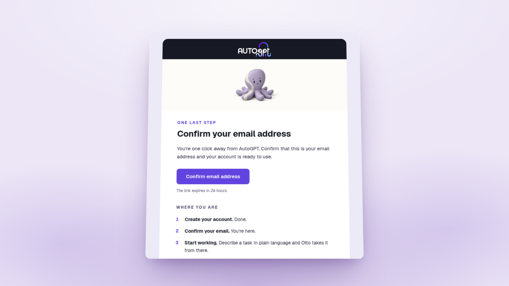

# Connect tools from the chat, a login page that shows what's new, and a friendlier first email

*November 4, 2026*

**Platform versions:** `v0.11.0`

## Connect a tool without leaving the chat

Type **@** and the name of a tool you haven't connected yet, and the list now ends with **Connect an integration**. It opens the **Connect a service** dialog already searching for what you typed, and once you connect, the new account is ready to mention. The dialog itself opens on the services most people want, Google, GitHub, Notion, Linear, Discord, X, HubSpot and Airtable, with a line under each saying what it covers, and the rest follow in order of popularity. When Otto needs an account to continue, its card now names the app, shows which account it will use and lets you switch or sign in from there. [#16306](https://github.com/Significant-Gravitas/AutoGPT/pull/16306) [#16316](https://github.com/Significant-Gravitas/AutoGPT/pull/16316) [#16280](https://github.com/Significant-Gravitas/AutoGPT/pull/16280)

<figure><figcaption>
From @ to connected, in the chat
</figcaption></figure>

## The login page shows what's new

The **What's new** panel on the login page now lists the three latest releases from this changelog, each linking to its page. The signup page describes what you're signing up for: a team of AI experts, led by Otto, that takes work off your plate. [#16326](https://github.com/Significant-Gravitas/AutoGPT/pull/16326) [#16314](https://github.com/Significant-Gravitas/AutoGPT/pull/16314)

<figure><figcaption>
The latest releases on the login page, and the new signup panel
</figcaption></figure>

## A friendlier "Confirm your email" email

The email that confirms your address, often the first one you get from AutoGPT, now matches the rest of our emails: Otto at the top, one clear button, and three steps that show where you are in getting started. [#16279](https://github.com/Significant-Gravitas/AutoGPT/pull/16279)

<figure><figcaption>
The new confirmation email
</figcaption></figure>

✨ Improvements

- **You can tell when Otto is done:** the latest reply ends with "Done in 2m 14s" when it finished, or "Stopped after 8s" when you stopped it. ([#16225](https://github.com/Significant-Gravitas/AutoGPT/pull/16225))
- **Long tasks speak plainly and show a clock:** "Picking up where we left off…" instead of internal wording, and a timer on any step that runs for a while. ([#16226](https://github.com/Significant-Gravitas/AutoGPT/pull/16226))
- **Turn on notifications from the chat in one click,** so you hear when Otto or your Experts finish. ([#16227](https://github.com/Significant-Gravitas/AutoGPT/pull/16227))
- **Thumbs up and down work on a reply that just finished,** without a reload. ([#16228](https://github.com/Significant-Gravitas/AutoGPT/pull/16228))
- **A shorter spend check-in:** when an Expert passes the spending check-in you set, the card reads "Maria has done 300 credits of work this week" with **Keep going** or **Cancel**, and every paused run waits under one approval instead of only the newest. ([#16352](https://github.com/Significant-Gravitas/AutoGPT/pull/16352), [#16303](https://github.com/Significant-Gravitas/AutoGPT/pull/16303))
- **Hiring an Expert yourself completes the wallet's marketplace task** and earns its $1. ([#16391](https://github.com/Significant-Gravitas/AutoGPT/pull/16391))
- **New blocks:** Parallel's yes/no, choice and score decisions, answered from current web sources. ([#16310](https://github.com/Significant-Gravitas/AutoGPT/pull/16310))
- **New models:** Gemini 3.5 Flash, Gemini 3.5 Flash Lite and Gemini 3.1 Flash Lite. ([#15087](https://github.com/Significant-Gravitas/AutoGPT/pull/15087))
- **Favorites search finds every favorite,** and the library briefing counts your whole library. ([#16467](https://github.com/Significant-Gravitas/AutoGPT/pull/16467), [#16510](https://github.com/Significant-Gravitas/AutoGPT/pull/16510))

🎨 UI/UX Improvements

- **All eight onboarding roles fit on a phone** in a two-column grid. ([#16256](https://github.com/Significant-Gravitas/AutoGPT/pull/16256))
- **A menu you open while Home is loading stays open,** such as the profile menu. ([#16342](https://github.com/Significant-Gravitas/AutoGPT/pull/16342))
- **The memory chat points you to a plan** when yours doesn't include it, instead of showing an error. ([#16177](https://github.com/Significant-Gravitas/AutoGPT/pull/16177))

🐛 Bug Fixes

- **You stay signed in** through a network blip or an update. ([#15386](https://github.com/Significant-Gravitas/AutoGPT/pull/15386))
- **An open tab picks up an update** instead of leaving a button that does nothing. ([#16312](https://github.com/Significant-Gravitas/AutoGPT/pull/16312))
- **Links to app pages in a reply open** instead of showing "[blocked]". ([#16466](https://github.com/Significant-Gravitas/AutoGPT/pull/16466))
- **A declined card on auto top-up says why** and tries your next saved card. ([#15600](https://github.com/Significant-Gravitas/AutoGPT/pull/15600))
- **The onboarding brain dump accepts real answers** it used to reject: typed answers, long ones and answers in Indic scripts. ([#16344](https://github.com/Significant-Gravitas/AutoGPT/pull/16344), [#16571](https://github.com/Significant-Gravitas/AutoGPT/pull/16571))
- **Ten X blocks accept your X connection.** ([#16388](https://github.com/Significant-Gravitas/AutoGPT/pull/16388))
- **Workflows on retired Claude models move to the closest current one** instead of the platform default. ([#16191](https://github.com/Significant-Gravitas/AutoGPT/pull/16191))

