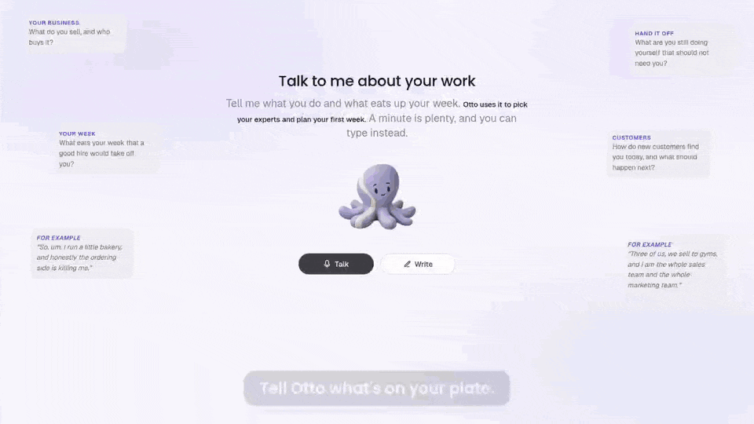
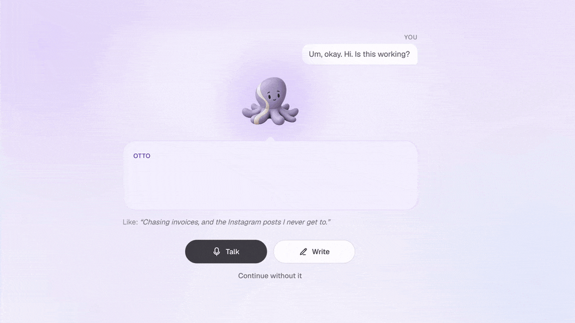
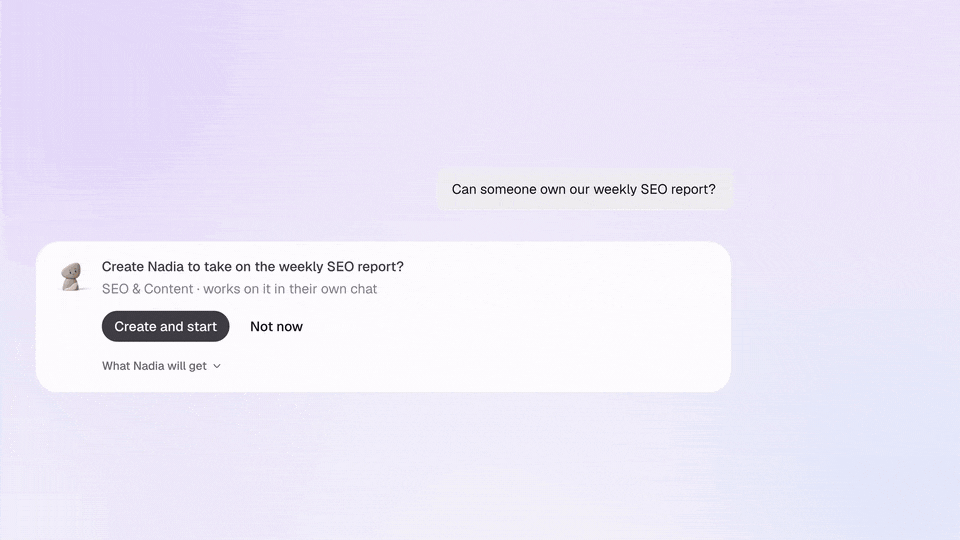

# Your plan before your trial, Wix for your team, and Otto replies on a short brain dump

*November 6 – November 11, 2026*

**Platform versions:** `v0.11.1` · `v0.11.2`

## See your plan before you start your trial

The last step of onboarding now shows what your team will do before it asks for a card. Otto's plan sums up what Otto heard in your brain dump and lists your first three tasks in order, each with the Expert who will take it, next to your free trial and its timeline. The separate step for picking Experts is gone: the team in your plan joins when your trial starts. Home then opens on the same tasks, with **Start here** on the first one and the Expert who takes each. Remove a task you don't want, or hide the list until you need it. [#16308](https://github.com/Significant-Gravitas/AutoGPT/pull/16308)

<figure><figcaption>
Plan first, then try it free
</figcaption></figure>

## Wix joins the apps your team can use

Wix is now in **Connect a service**. Type **@wix** in the chat, or search for it in the dialog, sign in with your Wix account, and Otto and your Experts can work on your Wix sites. [#16650](https://github.com/Significant-Gravitas/AutoGPT/pull/16650)

<figure><figcaption>
Type @ and the app, and connect it right there
</figcaption></figure>

## Otto replies when your brain dump is too short

When what you said in onboarding is too short to plan from, such as a quick "Is this working?", the screen no longer reads like an error. It shows what Otto heard, Otto's reply and one easy question, "What do you want off your plate?", with an example for your role. **Talk** stays the main button, **Write** sits next to it, and the question stays in view while you answer. [#16654](https://github.com/Significant-Gravitas/AutoGPT/pull/16654)

<figure><figcaption>
Otto shows what it heard and asks one easy question
</figcaption></figure>

## Start a new Expert's chat in one click

When Otto suggests creating an Expert for something you asked for, the card now has **Create and start**. It creates the Expert and hands over the task in their own chat, the way **Hire and start** already does for hiring. Create or hire an Expert without a task and the card offers **Chat with** them, which opens their first chat with a short introduction. New Experts also show in **Recent chats** before you've talked to them, on desktop and in the phone menu. [#16689](https://github.com/Significant-Gravitas/AutoGPT/pull/16689)

<figure><figcaption>
Create and start hands the task to the new Expert
</figcaption></figure>

✨ Improvements

- **An action that needs your approval shows its card in the chat right away,** such as sending a Gmail message, instead of only after a reload, and **Needs you** on Home names the Expert who asked. ([#16697](https://github.com/Significant-Gravitas/AutoGPT/pull/16697))
- **Run a skill with a slash:** type **/** at the start of a message to see the chat's skills, and anything you type after the skill's name is passed to it. ([#14991](https://github.com/Significant-Gravitas/AutoGPT/pull/14991))
- **A few short questions you can skip:** why you're canceling a trial, how a finished task went, and a check when Otto thinks it got something wrong. ([#16348](https://github.com/Significant-Gravitas/AutoGPT/pull/16348))
- **The run card in a chat follows the run to the end,** and shows the error when it fails or stops. ([#16587](https://github.com/Significant-Gravitas/AutoGPT/pull/16587), [#16617](https://github.com/Significant-Gravitas/AutoGPT/pull/16617))
- **The side panel follows a file Otto rewrites,** so you see the new version without a click. ([#16640](https://github.com/Significant-Gravitas/AutoGPT/pull/16640))
- **A canceled trial gets a reminder** 3 days and 1 day before access ends, with **Resume my trial**. ([#16506](https://github.com/Significant-Gravitas/AutoGPT/pull/16506))
- **Middle-click or Cmd/Ctrl-click a link to an app page** in a reply to open it in a new tab. ([#16584](https://github.com/Significant-Gravitas/AutoGPT/pull/16584))
- **A workflow with a trigger can also take its own inputs.** ([#11220](https://github.com/Significant-Gravitas/AutoGPT/pull/11220))
- **New models:** Claude Fable 5.2, Meta Muse Ember and Tencent Hy4. ([#16699](https://github.com/Significant-Gravitas/AutoGPT/pull/16699), [#16700](https://github.com/Significant-Gravitas/AutoGPT/pull/16700), [#16605](https://github.com/Significant-Gravitas/AutoGPT/pull/16605))
- **New blocks:** Firecrawl's data tools for people, company and other records, 21 Treg blocks for people, company and web data, and new Exa blocks for its current API, with the Exa Research blocks working again. ([#16561](https://github.com/Significant-Gravitas/AutoGPT/pull/16561), [#16393](https://github.com/Significant-Gravitas/AutoGPT/pull/16393), [#16395](https://github.com/Significant-Gravitas/AutoGPT/pull/16395))

🎨 UI/UX Improvements

- **The first onboarding screen introduces your team,** with each Expert's role under their name and a line on what a few of them do, and its names are easy to read on a phone. ([#16623](https://github.com/Significant-Gravitas/AutoGPT/pull/16623))
- **Otto's points on the Meet Otto screen line up.** ([#16620](https://github.com/Significant-Gravitas/AutoGPT/pull/16620))
- **A number too long for a JSON field gets a hint** to put it in quotes so every digit is kept. ([#16710](https://github.com/Significant-Gravitas/AutoGPT/pull/16710))

🐛 Bug Fixes

- **The Unsubscribe link in our emails opens a page to confirm** instead of an error. ([#16670](https://github.com/Significant-Gravitas/AutoGPT/pull/16670))
- **New accounts start with onboarding,** not a plan or credits prompt, including after you switch accounts. ([#16629](https://github.com/Significant-Gravitas/AutoGPT/pull/16629))
- **Home stays put after you pay during onboarding** instead of jumping back and forth. ([#16671](https://github.com/Significant-Gravitas/AutoGPT/pull/16671))
- **Paying early during a trial starts your plan** instead of leaving the paywall up. ([#16649](https://github.com/Significant-Gravitas/AutoGPT/pull/16649))
- **An Expert's run with a failed step shows as failed,** never as done. ([#16684](https://github.com/Significant-Gravitas/AutoGPT/pull/16684))
- **Otto no longer says a connected account isn't connected** when the app turns down a request, and names the cause of a failure only when the error states it. ([#16704](https://github.com/Significant-Gravitas/AutoGPT/pull/16704), [#16586](https://github.com/Significant-Gravitas/AutoGPT/pull/16586))
- **An AI step too large for its provider stops at once** with a clear message instead of retrying. ([#16703](https://github.com/Significant-Gravitas/AutoGPT/pull/16703))
- **Optional workflow inputs work:** with Advanced on, an input can be left blank. ([#16706](https://github.com/Significant-Gravitas/AutoGPT/pull/16706))
- **A run's output file no longer replaces an earlier one with the same name,** and is saved beside it as `output (1)`. ([#16343](https://github.com/Significant-Gravitas/AutoGPT/pull/16343))
- **Chat keeps text that looks like a tag,** such as `<first name>`, and shell text like `$HOME` stays text instead of turning into math. ([#16426](https://github.com/Significant-Gravitas/AutoGPT/pull/16426), [#16559](https://github.com/Significant-Gravitas/AutoGPT/pull/16559))
- **Delete Telegram Message reports success** when the message is deleted. ([#16216](https://github.com/Significant-Gravitas/AutoGPT/pull/16216))
- **An image with the wrong file extension uploads.** ([#12017](https://github.com/Significant-Gravitas/AutoGPT/pull/12017))
- **A creator's Marketplace card counts only the workflows on their page.** ([#16614](https://github.com/Significant-Gravitas/AutoGPT/pull/16614))

