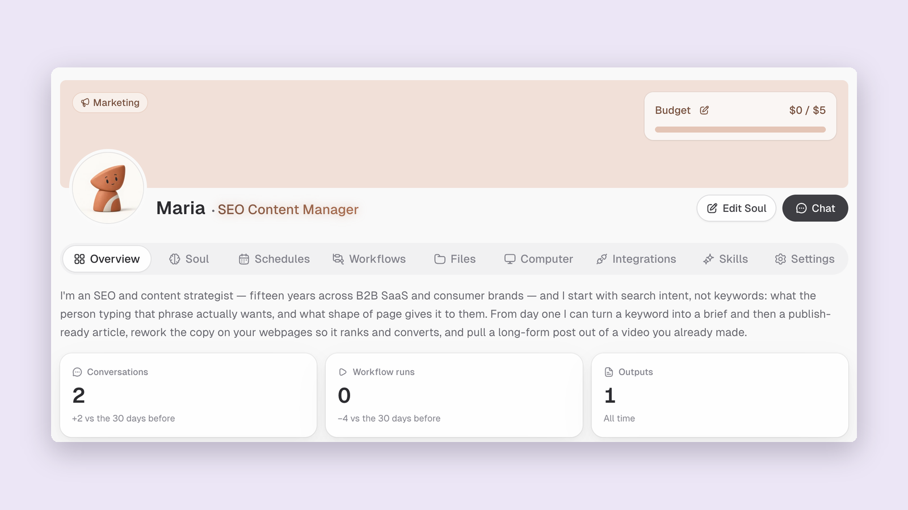

# Chats that pick up where they paused, and a clearer view of your team

*October 21, 2026*

**Platform version:** `v0.9.0`

## Pick up where Otto paused

Reaching a usage limit no longer has to end a task with a red error. Otto can save a checkpoint of what is done and what comes next, then show a **Paused** card. A long run offers **Keep going** or **Stop here**. When a daily or weekly allowance runs out, the card shows when it resets and offers to resume after that. If Otto was stopped before saving a checkpoint, the card says so. [#15388](https://github.com/Significant-Gravitas/AutoGPT/pull/15388) [#15401](https://github.com/Significant-Gravitas/AutoGPT/pull/15401)

You can also write your next message while you are out of allowance and choose **Send at reset**. A chip shows its scheduled time, with **Edit** and **Cancel** while it is waiting. The draft and pending send survive a reload, and a failed scheduling request puts the message back where you can recover it. This is available when your allowance has a reset time; an exhausted trial needs a plan instead. [#15390](https://github.com/Significant-Gravitas/AutoGPT/pull/15390) [#15403](https://github.com/Significant-Gravitas/AutoGPT/pull/15403) [#15591](https://github.com/Significant-Gravitas/AutoGPT/pull/15591) [#15592](https://github.com/Significant-Gravitas/AutoGPT/pull/15592)

## Know what is left, and what an upgrade costs

Usage notices now explain which allowance ran out and when you can continue. A running-low hint helps you decide whether to start a longer task. New free trials receive one chat allowance for the whole trial, which you can use at your own pace; existing trials keep their saved terms. [#15403](https://github.com/Significant-Gravitas/AutoGPT/pull/15403) [#15184](https://github.com/Significant-Gravitas/AutoGPT/pull/15184)

Starting Pro during an active trial shows the charge and next payment date before you confirm, and explains that starting now ends the trial early. Pro-to-Max upgrades show a proration quote first. A trial's first paid conversion to Pro or Max starts with fresh daily and weekly usage once payment is confirmed; ordinary paid-plan upgrades do not reset what you have already used. [#15215](https://github.com/Significant-Gravitas/AutoGPT/pull/15215) [#15208](https://github.com/Significant-Gravitas/AutoGPT/pull/15208)

## Routines tell you when they need help

A scheduled chat that cannot run now leaves a note explaining why, with an action to help you fix it. A one-time task blocked by a daily or weekly allowance can wait for the reset instead of disappearing. [#15374](https://github.com/Significant-Gravitas/AutoGPT/pull/15374)

If three runs in a row fail outright for the same reason, the schedule pauses and appears under **Needs you** on Home. Open its chat to reconnect the missing service or resume it. Reconnecting a provider from another page also resumes chats paused on that connection. If a single step keeps failing but the rest of the run still delivers, you get a note and the schedule keeps running. [#15375](https://github.com/Significant-Gravitas/AutoGPT/pull/15375) [#15377](https://github.com/Significant-Gravitas/AutoGPT/pull/15377)

For recurring chats that keep using up your allowance, **Run less often** offers a slower schedule directly from the usage-limit note. You can keep the routine useful without increasing your plan. [#15400](https://github.com/Significant-Gravitas/AutoGPT/pull/15400)

## See what each Expert has been doing

Expert pages have a new **Overview** with conversation and workflow-run counts, recent activity, and the latest outputs. **Soul** has its own tab for identity, voice and boundaries, and **Files** brings the Expert's files together with search and filters. The Team page has clearer search, category filters and empty states, and the layouts fit smaller screens. [#15500](https://github.com/Significant-Gravitas/AutoGPT/pull/15500)

<figure><figcaption>
Your Expert's activity and settings, together on its page
</figcaption></figure>

## Chat more comfortably on your phone

The composer gives your message more room and keeps its controls above the phone's safe area. On touch devices, **Take photo** in the **+** menu sends a camera shot through the usual attachment flow. Extra controls live in **More options**. [#15545](https://github.com/Significant-Gravitas/AutoGPT/pull/15545)

The keyboard stays closed until you need it and dismisses after sending. Message actions are visible without hovering, long links wrap, and the sidebar closes when you pick a chat. Your sidebar's open or closed choice also survives a reload. [#15769](https://github.com/Significant-Gravitas/AutoGPT/pull/15769) [#15574](https://github.com/Significant-Gravitas/AutoGPT/pull/15574)

## Self-host with the published image, including on Windows

The self-hosting guides now start with the published Docker Hub image, and the single-container install is out of experimental status. Windows has a PowerShell installer alongside the Linux and macOS installer, with the same install, update and lifecycle options. See [Setting Up AutoGPT](../getting-started.md) and the [installer guide](../installer.md). [#14553](https://github.com/Significant-Gravitas/AutoGPT/pull/14553)

✨ Improvements

- **Long chats feel lighter:** opening and scrolling a long conversation renders the visible messages, while the composer stays steady as a reply streams. ([#15740](https://github.com/Significant-Gravitas/AutoGPT/pull/15740), [#15716](https://github.com/Significant-Gravitas/AutoGPT/pull/15716))
- **Follow-up replies get relevant saved memories again,** and memory extraction better preserves concrete details from your requests. ([#15003](https://github.com/Significant-Gravitas/AutoGPT/pull/15003), [#15677](https://github.com/Significant-Gravitas/AutoGPT/pull/15677))
- **Morning briefings start in a fresh Otto chat,** so each day's briefing has its own place. ([#15222](https://github.com/Significant-Gravitas/AutoGPT/pull/15222))
- **Connections renew more reliably:** eligible accounts refresh before expiry, idle connections get maintenance, and rotating refresh tokens are protected from competing refreshes. ([#15619](https://github.com/Significant-Gravitas/AutoGPT/pull/15619), [#15639](https://github.com/Significant-Gravitas/AutoGPT/pull/15639), [#15647](https://github.com/Significant-Gravitas/AutoGPT/pull/15647))
- **Claude Haiku 5.5 and Meta Muse Spark Open** join the model catalog. ([#15307](https://github.com/Significant-Gravitas/AutoGPT/pull/15307), [#15566](https://github.com/Significant-Gravitas/AutoGPT/pull/15566))
- **YouTube embeds wait for marketing-cookie consent.** You can open the video on YouTube instead; self-hosted installs without a consent banner offer a per-video **Load video** button. ([#15751](https://github.com/Significant-Gravitas/AutoGPT/pull/15751))

🐛 Bug Fixes

- **Files sent from an Expert's side-panel chat reach the Expert,** and your message and attachments appear immediately. ([#15582](https://github.com/Significant-Gravitas/AutoGPT/pull/15582))
- **Japanese, Chinese and Korean input works in question cards and JSON editors.** Editing in the middle of a value no longer jumps the cursor or discards unfinished text. ([#15649](https://github.com/Significant-Gravitas/AutoGPT/pull/15649))
- **Workflow steps resumed after review are not charged twice.** ([#15327](https://github.com/Significant-Gravitas/AutoGPT/pull/15327))
- **Public run links include outputs entered directly in the Builder,** matching the owner's output view. ([#15654](https://github.com/Significant-Gravitas/AutoGPT/pull/15654))
- **Deleting a chat no longer waits for background cleanup.** ([#15579](https://github.com/Significant-Gravitas/AutoGPT/pull/15579))
- **Long filenames containing multibyte characters upload safely,** and blank or very long Marketplace searches no longer break the results page. ([#15653](https://github.com/Significant-Gravitas/AutoGPT/pull/15653), [#15587](https://github.com/Significant-Gravitas/AutoGPT/pull/15587))

