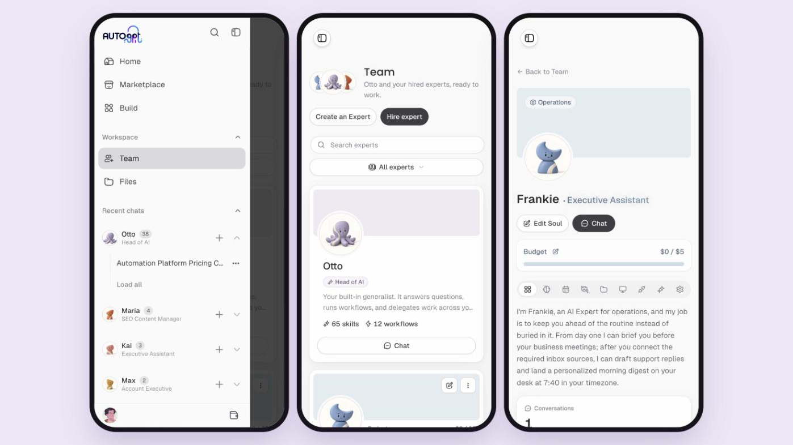

# Expert pages with an Overview, an app that fits your phone, and a lighter login

*October 23, 2026*

**Platform versions:** `v0.9.0`

## Expert pages that show how your team is doing

The Team page and every Expert's page were redesigned. Team has search and a category filter, and each card shows the Expert's role, budget, skills and workflows. Open an Expert and you land on a new **Overview** tab: a short introduction in the Expert's own words, conversations, workflow runs and outputs compared with the 30 days before, a chart of the last 30 days and an activity grid. The Expert's personality and instructions moved to their own **Soul** tab, and its files to a **Files** tab, next to Schedules, Workflows, Computer, Integrations, Skills and Settings. [#15500](https://github.com/Significant-Gravitas/AutoGPT/pull/15500)

<figure><figcaption>
From the Team page to an Expert's Overview and Soul
</figcaption></figure>

## Built for your phone

Chat, the sidebar, the Team page and Expert pages were reworked for small screens. The keyboard no longer pops up when a chat opens and closes after you send, message actions are always visible and easy to tap, long links and code wrap instead of running off the screen, and the menu closes as soon as you pick a page. On a phone the **+** menu has **Take photo**, which opens the camera and attaches the shot. Images you attach now show as small pictures in the chat box and in the conversation, so you can see which photo you sent without opening the side panel. [#15500](https://github.com/Significant-Gravitas/AutoGPT/pull/15500) [#15545](https://github.com/Significant-Gravitas/AutoGPT/pull/15545) [#15769](https://github.com/Significant-Gravitas/AutoGPT/pull/15769) [#15692](https://github.com/Significant-Gravitas/AutoGPT/pull/15692) [#15882](https://github.com/Significant-Gravitas/AutoGPT/pull/15882)

<figure><figcaption>
The sidebar, the Team page and an Expert page on a phone
</figcaption></figure>

## A lighter, faster login and signup

Login and signup now look like the rest of the app: a light side panel with Otto and two Experts, white cards and the same type as the Marketplace. The animated backgrounds are gone, so the first page new people see loads faster, especially on phones. [#15876](https://github.com/Significant-Gravitas/AutoGPT/pull/15876)

<figure><figcaption>
The new login page
</figcaption></figure>

## See what's new without leaving the app

When a new release comes out, a small **What's new** card appears in the corner of the app with the release dates, its top three changes and a link to the full changelog. It shows once per release and fades after a few seconds, and hovering over it keeps it open. [#12652](https://github.com/Significant-Gravitas/AutoGPT/pull/12652)

<figure><figcaption>
The What's new card links straight to this changelog
</figcaption></figure>

✨ Improvements

- **Otto pauses at a usage limit instead of failing:** a reply that reaches your limit stops with its progress saved and a Paused card in the chat that says when your budget resets, with **Resume** at that time or **Upgrade**. A very long task checks in with **Keep going** or **Stop here**. ([#15388](https://github.com/Significant-Gravitas/AutoGPT/pull/15388), [#15390](https://github.com/Significant-Gravitas/AutoGPT/pull/15390), [#15401](https://github.com/Significant-Gravitas/AutoGPT/pull/15401))
- **Write now, send when your budget resets:** with no budget left you can still type a message and choose **Send at reset**, and a hint warns you when today's budget is running low. ([#15403](https://github.com/Significant-Gravitas/AutoGPT/pull/15403))
- **Clearer trial and upgrade charges:** a trial can start its paid plan early with **Start Pro now**, showing the price and start date first, a trial whose first charge failed shows one **Pay now** button, and an upgrade shows the exact charge before you confirm. ([#15215](https://github.com/Significant-Gravitas/AutoGPT/pull/15215))
- **Scheduled chats say what went wrong:** a skipped run leaves one note saying why, with the fix on a button; a chat that keeps failing the same way pauses itself, tells you, shows up on Home and resumes when you reconnect the account it needs; and a usage-limit note offers **Run less often**. ([#15374](https://github.com/Significant-Gravitas/AutoGPT/pull/15374), [#15375](https://github.com/Significant-Gravitas/AutoGPT/pull/15375), [#15377](https://github.com/Significant-Gravitas/AutoGPT/pull/15377), [#15400](https://github.com/Significant-Gravitas/AutoGPT/pull/15400))
- **Hire the whole recommended team in one click** during onboarding, with a tick on each card to leave someone out. ([#15836](https://github.com/Significant-Gravitas/AutoGPT/pull/15836))
- **A new Expert's first questions are easier to answer:** pick more than one option, check your answers before sending, and use the keyboard anywhere in the card. ([#15874](https://github.com/Significant-Gravitas/AutoGPT/pull/15874))
- **Otto's suggested first tasks stay on Home** until you hide them, and the ones you started show as in progress. ([#15837](https://github.com/Significant-Gravitas/AutoGPT/pull/15837))
- **Answered questions stay readable in the chat,** including after a reload and in shared chats. ([#15873](https://github.com/Significant-Gravitas/AutoGPT/pull/15873))
- **Otto can look at images in your files,** including PDF pages and video frames it renders. ([#15725](https://github.com/Significant-Gravitas/AutoGPT/pull/15725))
- **Each morning briefing opens in its own Otto chat** instead of landing in your latest conversation. ([#15222](https://github.com/Significant-Gravitas/AutoGPT/pull/15222))
- **New models:** Claude Haiku 5.5 and Meta Muse Spark Open. ([#15307](https://github.com/Significant-Gravitas/AutoGPT/pull/15307), [#15566](https://github.com/Significant-Gravitas/AutoGPT/pull/15566))
- **New blocks:** **Update Notion page properties** and **Append to Notion page**, and a block that emails you your own result with no sign-in needed. ([#15861](https://github.com/Significant-Gravitas/AutoGPT/pull/15861), [#15838](https://github.com/Significant-Gravitas/AutoGPT/pull/15838))

🎨 UI/UX Improvements

- **The sidebar layout is the only layout,** so pages no longer flash the old top bar while loading. ([#15106](https://github.com/Significant-Gravitas/AutoGPT/pull/15106))
- **The sidebar remembers whether you left it open or closed.** ([#15574](https://github.com/Significant-Gravitas/AutoGPT/pull/15574))
- **Tooltips no longer block clicks** on what is underneath them. ([#14370](https://github.com/Significant-Gravitas/AutoGPT/pull/14370))
- **A shared Marketplace link previews with its one-line summary** instead of a cut-off description. ([#14496](https://github.com/Significant-Gravitas/AutoGPT/pull/14496))
- **Otto, your Experts and workflows are named correctly** in the usage-limit, billing and confirmation messages that still used older names. ([#15590](https://github.com/Significant-Gravitas/AutoGPT/pull/15590), [#15704](https://github.com/Significant-Gravitas/AutoGPT/pull/15704), [#15768](https://github.com/Significant-Gravitas/AutoGPT/pull/15768))

🐛 Bug Fixes

- **Needs you updates right after you answer a question.** ([#15501](https://github.com/Significant-Gravitas/AutoGPT/pull/15501))
- **A second tap right after Send no longer stops your message.** ([#15547](https://github.com/Significant-Gravitas/AutoGPT/pull/15547))
- **A message sent right after Stop stays on screen,** and sending the same message again works once the last one finished. ([#15931](https://github.com/Significant-Gravitas/AutoGPT/pull/15931), [#15918](https://github.com/Significant-Gravitas/AutoGPT/pull/15918))
- **A message set to send at reset from a new chat survives a reload.** ([#15592](https://github.com/Significant-Gravitas/AutoGPT/pull/15592))
- **Files attached in an Expert's side-panel chat are sent,** and your message shows at once. ([#15582](https://github.com/Significant-Gravitas/AutoGPT/pull/15582))
- **Deleting a chat is instant.** ([#15579](https://github.com/Significant-Gravitas/AutoGPT/pull/15579))
- **The tab title no longer shows a growing activity counter.** ([#15568](https://github.com/Significant-Gravitas/AutoGPT/pull/15568))
- **Typing in Japanese, Chinese or Korean works** in fields that reformat what you type. ([#15649](https://github.com/Significant-Gravitas/AutoGPT/pull/15649))
- **A long or blank Marketplace search** no longer breaks the search page. ([#15587](https://github.com/Significant-Gravitas/AutoGPT/pull/15587))
- **Checkout buttons stay busy until the payment page opens,** and work when your browser translates the page. ([#15603](https://github.com/Significant-Gravitas/AutoGPT/pull/15603), [#15612](https://github.com/Significant-Gravitas/AutoGPT/pull/15612))
- **Onboarding:** the brain dump fits short screens, shows the 20,000-character limit as you type, and skips on the first click; leaving an Expert out of the hire step takes a mouse click again; and a slow connection no longer stops your answers from saving. ([#15610](https://github.com/Significant-Gravitas/AutoGPT/pull/15610), [#15960](https://github.com/Significant-Gravitas/AutoGPT/pull/15960), [#15927](https://github.com/Significant-Gravitas/AutoGPT/pull/15927), [#15957](https://github.com/Significant-Gravitas/AutoGPT/pull/15957), [#15814](https://github.com/Significant-Gravitas/AutoGPT/pull/15814))
- **Billing and trial emails** have the right amounts and dates and fit phone screens. ([#15552](https://github.com/Significant-Gravitas/AutoGPT/pull/15552))

