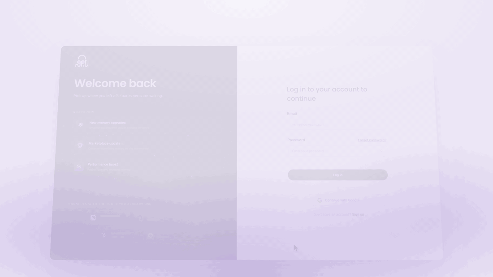
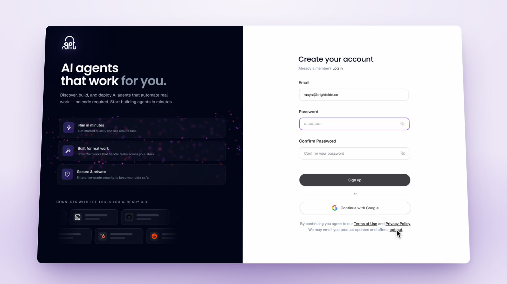

# A clearer wallet, a kinder trial, and shorter replies from Otto

*October 8 – October 14, 2026*

**Platform versions:** `v0.8.3` · `v0.8.4`

## Sign up with less in the way

The signup page lost its checkbox and its demo link. "Already a member? Log in" sits under the title, and one line under the buttons covers the terms and privacy policy and lets you opt out of marketing email with a single click. Email sign-ups verify their address before the first session, so one person cannot spin up trial after trial. Once you are signed in and onboarded you land straight on Home. [#15152](https://github.com/Significant-Gravitas/AutoGPT/pull/15152) [#15135](https://github.com/Significant-Gravitas/AutoGPT/pull/15135) [#15095](https://github.com/Significant-Gravitas/AutoGPT/pull/15095) [#15155](https://github.com/Significant-Gravitas/AutoGPT/pull/15155) [#15201](https://github.com/Significant-Gravitas/AutoGPT/pull/15201)

<figure><figcaption>
Logging in: the front door of the platform
</figcaption></figure>

<figure><figcaption>
One line under the buttons replaces the checkbox
</figcaption></figure>

## Chat usage and credits in one wallet

The wallet in the sidebar is now an icon, and the popover shows two things: your chat usage, the allowance for conversations with Otto and your Experts, and your automation credits. Paid plans see their daily and weekly windows, trials see their allowance and end date, and the eight ways to earn credits sit in a collapsible section underneath. [#15204](https://github.com/Significant-Gravitas/AutoGPT/pull/15204)

## Cancel a trial and keep it until it ends

Canceling a 7-day trial used to end your access the moment you clicked. Now it schedules the end: you keep the trial until its last day, you can resume it any time before then, and if you subscribe during a pending cancellation the plan takes over cleanly. Trial offers no longer show to accounts that already have a plan. [#15358](https://github.com/Significant-Gravitas/AutoGPT/pull/15358) [#15382](https://github.com/Significant-Gravitas/AutoGPT/pull/15382) [#15221](https://github.com/Significant-Gravitas/AutoGPT/pull/15221)

## Otto keeps it short

Otto and your Experts now answer first and keep most replies to a sentence or three: no preambles, no recap of what you said, no headers or bullet lists for simple answers, and one question at a time. A new hire opens with a short Typeform-style card instead of a page of text: a one-line greeting, two or three short questions, a handful of short options, and a thin progress bar. While Otto works you see "Thinking…" rather than backend status lines, and tables in replies have a cleaner style. [#15216](https://github.com/Significant-Gravitas/AutoGPT/pull/15216) [#15217](https://github.com/Significant-Gravitas/AutoGPT/pull/15217) [#15441](https://github.com/Significant-Gravitas/AutoGPT/pull/15441) [#15442](https://github.com/Significant-Gravitas/AutoGPT/pull/15442)

## Chats from the collapsed sidebar

The collapsed rail has a Chats item under Files. Click it and the sidebar expands and scrolls to your recent chats. The sidebar also scrolls anywhere now, the + next to an Expert group opens a fresh page for that Expert, and "Give feedback" lives in the account menu. [#15349](https://github.com/Significant-Gravitas/AutoGPT/pull/15349) [#15343](https://github.com/Significant-Gravitas/AutoGPT/pull/15343) [#15102](https://github.com/Significant-Gravitas/AutoGPT/pull/15102) [#15248](https://github.com/Significant-Gravitas/AutoGPT/pull/15248)

## It is a workflow

What the product used to call an agent is now a workflow, everywhere you read it: the Workflows page, the Builder, the Run dialog, search, the Activity menu, wallet tasks, Otto's cards and tool replies, approval cards, onboarding and the onboarding email. Otto, your Experts and your team keep their names. [#15251](https://github.com/Significant-Gravitas/AutoGPT/pull/15251)

✨ Improvements

- **New models:** GPT-6.1 Sol, Mistral Large 4, Mistral Medium 3.5, Mistral Small 4 and Ministral 3 (Medium 3.1 and Small 3.2 retired), Meta Muse Wonder and Google Gemini 4 Argon. ([#15070](https://github.com/Significant-Gravitas/AutoGPT/pull/15070), [#15203](https://github.com/Significant-Gravitas/AutoGPT/pull/15203), [#15210](https://github.com/Significant-Gravitas/AutoGPT/pull/15210), [#15480](https://github.com/Significant-Gravitas/AutoGPT/pull/15480), [#15496](https://github.com/Significant-Gravitas/AutoGPT/pull/15496))
- **Edit and combine suggested answers** in a question card instead of picking one as is. ([#15052](https://github.com/Significant-Gravitas/AutoGPT/pull/15052))
- **Press Enter to queue a follow-up while Otto is still answering.** ([#15105](https://github.com/Significant-Gravitas/AutoGPT/pull/15105))
- **Experts connect their integrations through MCP first.** ([#15199](https://github.com/Significant-Gravitas/AutoGPT/pull/15199))
- **New blocks:** GitHub repository traffic (views, clones, referrers, popular content), Hacker News search, stories, items and users, and Conductor. ([#15188](https://github.com/Significant-Gravitas/AutoGPT/pull/15188), [#15191](https://github.com/Significant-Gravitas/AutoGPT/pull/15191), [#14950](https://github.com/Significant-Gravitas/AutoGPT/pull/14950))
- **PayPal and Canva in the MCP catalog,** and sign in to the Slack and HubSpot MCP servers with a configured app. ([#14951](https://github.com/Significant-Gravitas/AutoGPT/pull/14951), [#15134](https://github.com/Significant-Gravitas/AutoGPT/pull/15134), [#15066](https://github.com/Significant-Gravitas/AutoGPT/pull/15066), [#15366](https://github.com/Significant-Gravitas/AutoGPT/pull/15366))
- **Clip, a video producer, joins the roster,** and Marketplace search finds Experts by job title. ([#15145](https://github.com/Significant-Gravitas/AutoGPT/pull/15145), [#15147](https://github.com/Significant-Gravitas/AutoGPT/pull/15147))
- **Home combines new tasks and the recap** in one place, and the Expert setup card stays off the hero. ([#15035](https://github.com/Significant-Gravitas/AutoGPT/pull/15035), [#15063](https://github.com/Significant-Gravitas/AutoGPT/pull/15063))
- **Onboarding asks for the paywall after personalization,** not before. ([#15196](https://github.com/Significant-Gravitas/AutoGPT/pull/15196))
- **Connect Telegram by messaging the bot first;** adding it to a group is optional. ([#15159](https://github.com/Significant-Gravitas/AutoGPT/pull/15159))
- **Office files render on the Files page,** including .pptx. ([#15359](https://github.com/Significant-Gravitas/AutoGPT/pull/15359))
- **Web search returns every cited source with its number,** and the HubSpot block asks for a private app token instead of the retired API key. ([#15186](https://github.com/Significant-Gravitas/AutoGPT/pull/15186), [#15367](https://github.com/Significant-Gravitas/AutoGPT/pull/15367))
- **A run that completes with errors says which step failed and why.** ([#15419](https://github.com/Significant-Gravitas/AutoGPT/pull/15419))
- **Transactional emails follow the design system** and render in more email clients. ([#15167](https://github.com/Significant-Gravitas/AutoGPT/pull/15167), [#15219](https://github.com/Significant-Gravitas/AutoGPT/pull/15219))
- **Web push notifications work from Edge, Safari and pre-release Chrome.** ([#15356](https://github.com/Significant-Gravitas/AutoGPT/pull/15356))
- **Community Replicate models run without a version hash.** ([#15128](https://github.com/Significant-Gravitas/AutoGPT/pull/15128))

🎨 UI/UX Improvements

- **One paywall toast with an upgrade link** when a send is refused. ([#15407](https://github.com/Significant-Gravitas/AutoGPT/pull/15407))
- **Builder chat says when no model is connected,** and spend is hidden without billing. ([#15439](https://github.com/Significant-Gravitas/AutoGPT/pull/15439))
- **Phones:** a dialog opened from a menu stays open, Enter adds a line instead of sending, and the Expert pill no longer overlaps the floating controls. ([#15064](https://github.com/Significant-Gravitas/AutoGPT/pull/15064), [#15082](https://github.com/Significant-Gravitas/AutoGPT/pull/15082), [#15448](https://github.com/Significant-Gravitas/AutoGPT/pull/15448), [#15455](https://github.com/Significant-Gravitas/AutoGPT/pull/15455))
- **Reconnect is offered** when a provider refuses a saved credential. ([#15160](https://github.com/Significant-Gravitas/AutoGPT/pull/15160))
- **Enterprise plans show as admin-managed** on the billing card. ([#15103](https://github.com/Significant-Gravitas/AutoGPT/pull/15103))

🐛 Bug Fixes

- **A queued message starts streaming as soon as it runs,** with no reload. ([#15346](https://github.com/Significant-Gravitas/AutoGPT/pull/15346))
- **A lost connection shows the finished answer** instead of "Failed to fetch", and no longer leaves false errors, spinners or endless retries behind. ([#15380](https://github.com/Significant-Gravitas/AutoGPT/pull/15380), [#15398](https://github.com/Significant-Gravitas/AutoGPT/pull/15398))
- **A message from another tab shows as a queued follow-up.** ([#15402](https://github.com/Significant-Gravitas/AutoGPT/pull/15402))
- **Billing accuracy:** each turn is charged its own cost, retried turns bill once for the attempt that succeeded, and a trial's status is read once per message. ([#15305](https://github.com/Significant-Gravitas/AutoGPT/pull/15305), [#15342](https://github.com/Significant-Gravitas/AutoGPT/pull/15342), [#15399](https://github.com/Significant-Gravitas/AutoGPT/pull/15399), [#15420](https://github.com/Significant-Gravitas/AutoGPT/pull/15420), [#15467](https://github.com/Significant-Gravitas/AutoGPT/pull/15467))
- **One running slot stays reserved for your own message** when subtasks fill the rest. ([#15347](https://github.com/Significant-Gravitas/AutoGPT/pull/15347), [#15361](https://github.com/Significant-Gravitas/AutoGPT/pull/15361))
- **Editing a schedule works end to end.** ([#15395](https://github.com/Significant-Gravitas/AutoGPT/pull/15395))
- **Scheduled runs use the account picked when the schedule was made.** ([#15132](https://github.com/Significant-Gravitas/AutoGPT/pull/15132))
- **Otto no longer stalls for a minute on a credentials lock,** and Home, Workflows and chat pages no longer wait on the scheduler. ([#15389](https://github.com/Significant-Gravitas/AutoGPT/pull/15389), [#15393](https://github.com/Significant-Gravitas/AutoGPT/pull/15393))
- **A resent message no longer runs twice.** ([#14939](https://github.com/Significant-Gravitas/AutoGPT/pull/14939))
- **Every sidebar, popup and Builder chat shows the same cards as the main chat.** ([#15067](https://github.com/Significant-Gravitas/AutoGPT/pull/15067))
- **Saving a workflow names the missing field,** and optional dropdowns no longer crash review cards and run forms. ([#15438](https://github.com/Significant-Gravitas/AutoGPT/pull/15438), [#15434](https://github.com/Significant-Gravitas/AutoGPT/pull/15434))
- **A long "Other" role in onboarding no longer loses your profile.** ([#15252](https://github.com/Significant-Gravitas/AutoGPT/pull/15252))
- **Pending subscription changes show up** even on slow reads, and a profile is created on first read instead of returning 404. ([#15427](https://github.com/Significant-Gravitas/AutoGPT/pull/15427), [#15426](https://github.com/Significant-Gravitas/AutoGPT/pull/15426))
- **Settings → Billing no longer creates a stray Stripe customer** that got admin-granted plans revoked. ([#15116](https://github.com/Significant-Gravitas/AutoGPT/pull/15116))
- **A provider's raw out-of-credits error is no longer shown to you.** ([#14882](https://github.com/Significant-Gravitas/AutoGPT/pull/14882))
- **Subtasks stay in the foreground** so their work reaches the reply. ([#15127](https://github.com/Significant-Gravitas/AutoGPT/pull/15127))
- **Deleted shared runs stop serving their page and files.** ([#15489](https://github.com/Significant-Gravitas/AutoGPT/pull/15489))
- **Self-hosted installs:** hosted-only interface stays out, signup grants work, and the memory page and no-model chat are fixed. ([#15408](https://github.com/Significant-Gravitas/AutoGPT/pull/15408), [#15409](https://github.com/Significant-Gravitas/AutoGPT/pull/15409))
- **Model prices match OpenRouter's live rates** for GPT-OSS 120B, DeepSeek V4.1 Flash and Kimi K2.6. ([#15042](https://github.com/Significant-Gravitas/AutoGPT/pull/15042), [#15071](https://github.com/Significant-Gravitas/AutoGPT/pull/15071), [#15139](https://github.com/Significant-Gravitas/AutoGPT/pull/15139))

