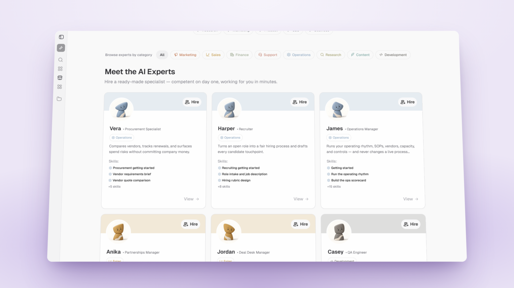

# A bigger roster, Clay & Rock avatars, folders in your workspace

*September 24 – September 30, 2026*

**Platform versions:** `v0.8.1` · `v0.8.2`

## The roster more than doubled

The Marketplace now carries Experts for most of the jobs a small team hires for. Eight generalists joined, among them Robin for support, Anika for partnerships, Alex for product, Daniel for finance, Sofia for recruiting, Maya for marketing and James for operations; Zara arrived as a go-to-market strategist; Max became the sales Expert with the full senior sales package folded in; and nine more core Experts followed. Each one ships with a voice, a bundle of skills, marketplace workflows for its domain and standing routines that stay off until you switch them on. Experts come first in the Marketplace, and hiring one now returns at once while its skills and workflows install in the background. [#14636](https://github.com/Significant-Gravitas/AutoGPT/pull/14636) [#14794](https://github.com/Significant-Gravitas/AutoGPT/pull/14794) [#14798](https://github.com/Significant-Gravitas/AutoGPT/pull/14798) [#14713](https://github.com/Significant-Gravitas/AutoGPT/pull/14713) [#14765](https://github.com/Significant-Gravitas/AutoGPT/pull/14765) [#14849](https://github.com/Significant-Gravitas/AutoGPT/pull/14849) [#14867](https://github.com/Significant-Gravitas/AutoGPT/pull/14867)

<figure><figcaption>
Browse the roster by category
</figcaption></figure>

## Clay & Rock, the new look for Experts

Every Expert is now a small sculpted clay figure, with a head shape of its own and cream accents, on a pastel background in its category's color: terracotta for Marketing, golden yellow for Sales, rose for Support, and so on. Otto keeps his lavender. When you raise an Expert you pick a face from the catalog or generate one live, choosing a category, shade, head shape and tilt, and review the result before you keep it. The onboarding illustration, team cards, chat headers and notification emails all use the same artwork. [#14822](https://github.com/Significant-Gravitas/AutoGPT/pull/14822) [#14858](https://github.com/Significant-Gravitas/AutoGPT/pull/14858) [#14948](https://github.com/Significant-Gravitas/AutoGPT/pull/14948) [#14933](https://github.com/Significant-Gravitas/AutoGPT/pull/14933) [#15008](https://github.com/Significant-Gravitas/AutoGPT/pull/15008) [#14994](https://github.com/Significant-Gravitas/AutoGPT/pull/14994)

<figure><figcaption>
Each Expert gets its own clay figure in its category's color
</figcaption></figure>

## Folders inside folders, and your files for your Experts

Workspace folders can nest now. Make a folder inside a folder on the Files page, move files and folders between them, and the folder you have open stays in the URL so a reload or a shared link lands in the same place. Experts can read the files you uploaded yourself, so you no longer get "File not found" when you ask Maria about a document on your Files page. Writing, renaming and deleting stay confined to each Expert's own conversations. [#14773](https://github.com/Significant-Gravitas/AutoGPT/pull/14773) [#14774](https://github.com/Significant-Gravitas/AutoGPT/pull/14774) [#14769](https://github.com/Significant-Gravitas/AutoGPT/pull/14769)

## Pick more than one answer

When Otto asks a question that has several right answers, the card now shows checkboxes instead of forcing one choice, and you can type alongside your picks. Your @ mentions reach your connected accounts too: type @ and pick a work Gmail or a GitHub login, and the message carries that exact account so Otto never guesses which one you meant. [#14741](https://github.com/Significant-Gravitas/AutoGPT/pull/14741) [#14775](https://github.com/Significant-Gravitas/AutoGPT/pull/14775)

## Try it free before you subscribe

The 7-day free trial now appears wherever plans do: on the paywall as well as in onboarding, with the trial price, a Start 7-day trial button and the trial details one click away. [#14876](https://github.com/Significant-Gravitas/AutoGPT/pull/14876) [#14768](https://github.com/Significant-Gravitas/AutoGPT/pull/14768)

✨ Improvements

- **New models:** Claude Sonnet 5.5 is the standard tier default, Claude Opus 5.5 the advanced one, and GPT-6 Luna the fast default; also Claude Opus 4.8, GPT-6 Sol, xAI Grok 4.7, GLM-5.3, Xiaomi MiMo-V2.6 Pro and Flash, Google Gemma 4 31B, Alibaba Qwen 3.8 Flash, Tencent Hy4, InclusionAI Ling 3.0 Flash VL and Unbiased Pareto. ([#15014](https://github.com/Significant-Gravitas/AutoGPT/pull/15014), [#14821](https://github.com/Significant-Gravitas/AutoGPT/pull/14821), [#14949](https://github.com/Significant-Gravitas/AutoGPT/pull/14949), [#14943](https://github.com/Significant-Gravitas/AutoGPT/pull/14943), [#14883](https://github.com/Significant-Gravitas/AutoGPT/pull/14883), [#14903](https://github.com/Significant-Gravitas/AutoGPT/pull/14903), [#14988](https://github.com/Significant-Gravitas/AutoGPT/pull/14988), [#14743](https://github.com/Significant-Gravitas/AutoGPT/pull/14743), [#14757](https://github.com/Significant-Gravitas/AutoGPT/pull/14757), [#14755](https://github.com/Significant-Gravitas/AutoGPT/pull/14755), [#14683](https://github.com/Significant-Gravitas/AutoGPT/pull/14683), [#14697](https://github.com/Significant-Gravitas/AutoGPT/pull/14697))
- **Hundreds of skills seeded into the Skills marketplace,** with per-Expert skill budgets and a cap of 150 installed skills per Expert. ([#14600](https://github.com/Significant-Gravitas/AutoGPT/pull/14600), [#14786](https://github.com/Significant-Gravitas/AutoGPT/pull/14786), [#14740](https://github.com/Significant-Gravitas/AutoGPT/pull/14740))
- **Formulas render:** inline `$…$` math shows as math in chat replies and markdown files, and prices like $5 stay plain text. ([#14790](https://github.com/Significant-Gravitas/AutoGPT/pull/14790), [#14807](https://github.com/Significant-Gravitas/AutoGPT/pull/14807))
- **AnySearch blocks:** search, parallel search and extract. ([#14792](https://github.com/Significant-Gravitas/AutoGPT/pull/14792))
- **Zapier, PostHog and OpenSEO in the MCP catalog,** including self-hosted OpenSEO instances. ([#14753](https://github.com/Significant-Gravitas/AutoGPT/pull/14753), [#14859](https://github.com/Significant-Gravitas/AutoGPT/pull/14859), [#14971](https://github.com/Significant-Gravitas/AutoGPT/pull/14971))
- **Otto knows it has a computer** and offers to use it. ([#14701](https://github.com/Significant-Gravitas/AutoGPT/pull/14701))
- **Fetched web pages keep their main content,** and Otto warns when a page is an empty JavaScript shell. ([#14875](https://github.com/Significant-Gravitas/AutoGPT/pull/14875))
- **Existing users are guided to their workflows** from Otto. ([#14935](https://github.com/Significant-Gravitas/AutoGPT/pull/14935))
- **The chat shows how many documents it holds,** and an Expert's files appear as rows on the Files page. ([#15029](https://github.com/Significant-Gravitas/AutoGPT/pull/15029), [#15033](https://github.com/Significant-Gravitas/AutoGPT/pull/15033))
- **Public Expert pages are indexed by search engines** and listed in the sitemap. ([#14902](https://github.com/Significant-Gravitas/AutoGPT/pull/14902), [#14901](https://github.com/Significant-Gravitas/AutoGPT/pull/14901))
- **Marketplace listings carry a short tagline,** so creators get one line to say what a workflow does. ([#14494](https://github.com/Significant-Gravitas/AutoGPT/pull/14494))
- **A real cookie banner:** Cookiebot asks for consent, records it, honors Global Privacy Control, and analytics stays off until you agree. ([#14838](https://github.com/Significant-Gravitas/AutoGPT/pull/14838))
- **Installed skills update in place** when the catalog publishes a new version; your edits win in a conflict. ([#14945](https://github.com/Significant-Gravitas/AutoGPT/pull/14945))

🎨 UI/UX Improvements

- **The artifact panel was realigned** and section titles lost their icons for one heading size everywhere. ([#14934](https://github.com/Significant-Gravitas/AutoGPT/pull/14934), [#15041](https://github.com/Significant-Gravitas/AutoGPT/pull/15041))
- **Expert cards and chat chips polished.** ([#15002](https://github.com/Significant-Gravitas/AutoGPT/pull/15002))
- **"Sent from" badge** on messages an Expert delegated. ([#14758](https://github.com/Significant-Gravitas/AutoGPT/pull/14758))
- **Accessibility:** the password reveal toggle works from the keyboard, builder fields have consistent labels, and clearing a dictionary key keeps the other entries. ([#12846](https://github.com/Significant-Gravitas/AutoGPT/pull/12846), [#12844](https://github.com/Significant-Gravitas/AutoGPT/pull/12844), [#12847](https://github.com/Significant-Gravitas/AutoGPT/pull/12847))
- **Adding a block no longer jumps the Builder viewport.** ([#13456](https://github.com/Significant-Gravitas/AutoGPT/pull/13456))

🐛 Bug Fixes

- **Google sign-in** sends the right verifier on token exchange. ([#14894](https://github.com/Significant-Gravitas/AutoGPT/pull/14894), [#14897](https://github.com/Significant-Gravitas/AutoGPT/pull/14897))
- **A failed transcription keeps your recording** and offers retry and download. ([#14706](https://github.com/Significant-Gravitas/AutoGPT/pull/14706))
- **Your message appears before its attachments finish uploading.** ([#14754](https://github.com/Significant-Gravitas/AutoGPT/pull/14754))
- **Too many attachments is refused when you add them,** not when you send. ([#14770](https://github.com/Significant-Gravitas/AutoGPT/pull/14770))
- **A follow-up typed mid-reply stays queued** until Otto picks it up. ([#14777](https://github.com/Significant-Gravitas/AutoGPT/pull/14777))
- **Reconnecting an account asks which one to update** instead of adding a duplicate. ([#14745](https://github.com/Significant-Gravitas/AutoGPT/pull/14745))
- **The Drive file you picked survives saving the workflow.** ([#14907](https://github.com/Significant-Gravitas/AutoGPT/pull/14907))
- **Skipped steps finish** instead of staying queued forever. ([#14921](https://github.com/Significant-Gravitas/AutoGPT/pull/14921))
- **An empty file picker asks for a file** instead of silently skipping. ([#14924](https://github.com/Significant-Gravitas/AutoGPT/pull/14924))
- **Read Spreadsheet block:** empty cells no longer turn into N/A, plus five other defects. ([#14749](https://github.com/Significant-Gravitas/AutoGPT/pull/14749))
- **A dead avatar or listing image falls back** to a placeholder. ([#14493](https://github.com/Significant-Gravitas/AutoGPT/pull/14493))
- **An owner-set avatar survives roster updates.** ([#14803](https://github.com/Significant-Gravitas/AutoGPT/pull/14803))
- **Opening a chat link on the wrong account says so.** ([#14975](https://github.com/Significant-Gravitas/AutoGPT/pull/14975))
- **Updating an Expert's skills no longer deletes ones the editor had not loaded.** ([#14884](https://github.com/Significant-Gravitas/AutoGPT/pull/14884))
- **Expert onboarding resumes in a new chat** and starts after a raise. ([#15038](https://github.com/Significant-Gravitas/AutoGPT/pull/15038), [#15034](https://github.com/Significant-Gravitas/AutoGPT/pull/15034))
- **Dollar signs in indented code stay as typed.** ([#14808](https://github.com/Significant-Gravitas/AutoGPT/pull/14808))
- **Expired sessions wait for auth** before showing an error. ([#13357](https://github.com/Significant-Gravitas/AutoGPT/pull/13357))
- **A turn that hit its budget resumes without resending work.** ([#13432](https://github.com/Significant-Gravitas/AutoGPT/pull/13432))
- **Streaming fixes:** text parts close before clearing events, retried identical sends replay the accepted result, and the first-turn context no longer renders inside your message. ([#14762](https://github.com/Significant-Gravitas/AutoGPT/pull/14762), [#14760](https://github.com/Significant-Gravitas/AutoGPT/pull/14760), [#14763](https://github.com/Significant-Gravitas/AutoGPT/pull/14763))
- **Model prices match OpenRouter's live rates** across the catalog. ([#14746](https://github.com/Significant-Gravitas/AutoGPT/pull/14746), [#14776](https://github.com/Significant-Gravitas/AutoGPT/pull/14776), [#14796](https://github.com/Significant-Gravitas/AutoGPT/pull/14796), [#14820](https://github.com/Significant-Gravitas/AutoGPT/pull/14820), [#14825](https://github.com/Significant-Gravitas/AutoGPT/pull/14825), [#14904](https://github.com/Significant-Gravitas/AutoGPT/pull/14904), [#14944](https://github.com/Significant-Gravitas/AutoGPT/pull/14944), [#14959](https://github.com/Significant-Gravitas/AutoGPT/pull/14959), [#14989](https://github.com/Significant-Gravitas/AutoGPT/pull/14989), [#15017](https://github.com/Significant-Gravitas/AutoGPT/pull/15017))
- **Self-hosted:** credential-free Ollama routes work. ([#14135](https://github.com/Significant-Gravitas/AutoGPT/pull/14135))

